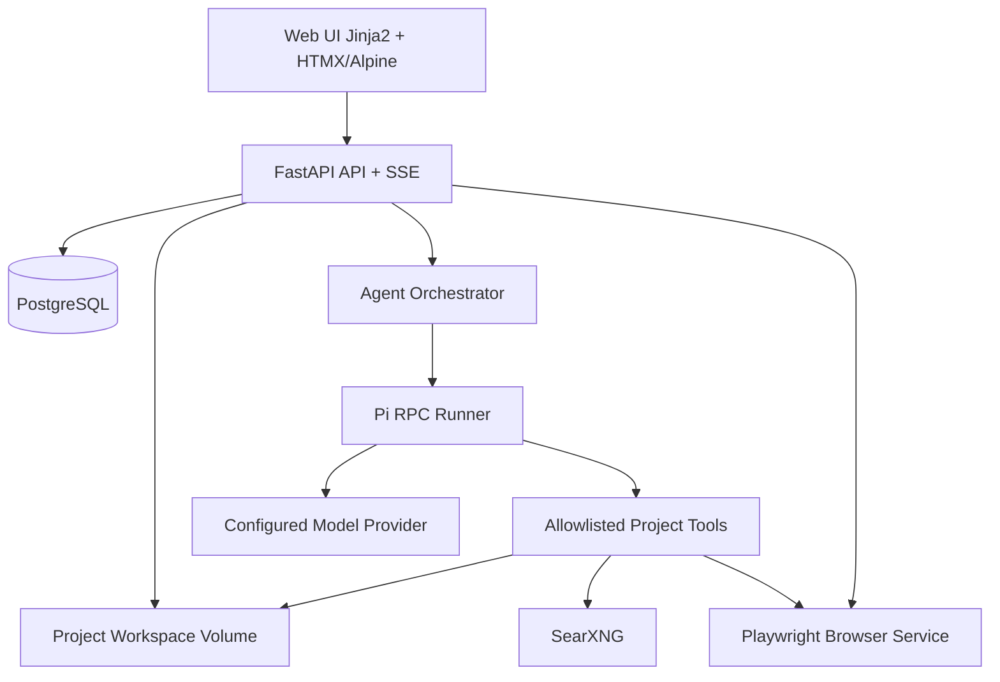

# PROJECT ARCHITECT — FULL PRODUCT, SYSTEM & UX SPECIFICATION

**Draft v1.0 · 2026-11-11 · For approval before coding**

Tài liệu này gồm Phần I (Product/System Specification) và Phần II (UI/UX Screen Blueprint). Hai phần cũng có bản Markdown riêng trong gói ZIP.

---

# PHẦN I — PRODUCT & SYSTEM SPECIFICATION

# PROJECT ARCHITECT — MASTER PRODUCT & SYSTEM SPECIFICATION

> **Tên làm việc:** Project Architect (có thể đổi trước khi triển khai)  
> **Phiên bản tài liệu:** 1.0 — Draft for Review  
> **Ngày:** 2026-11-11  
> **Trạng thái:** Đề xuất thiết kế, **CHƯA PHÊ DUYỆT, CHƯA VIẾT CODE**  
> **Ngôn ngữ ưu tiên giao diện:** Tiếng Việt; hỗ trợ mở rộng đa ngôn ngữ  
> **Mục tiêu tài liệu:** Đủ làm chuẩn đầu vào để Pi/coding agent triển khai, nhưng vẫn giữ quyền quyết định cuối cùng của người sở hữu dự án.

---

## 0. Tóm tắt quyết định đã thống nhất

| Mã | Quyết định | Trạng thái |
|---|---|---|
| DEC-001 | Xây web app chuyên phỏng vấn, thảo luận, nghiên cứu, lập phương án và xuất tài liệu đặc tả; **không tự động code sản phẩm của người dùng** | Chốt |
| DEC-002 | **BMAD Method** là phương pháp chính; kế thừa kỹ thuật hỏi từ Superpowers, GSD, OpenSpec, PRD Interviewer và Impeccable | Chốt |
| DEC-003 | **Pi agent RPC** là harness ưu tiên; giới hạn tool vào phạm vi workspace từng dự án | Chốt định hướng; cần spike tích hợp |
| DEC-004 | **SearXNG** là search backend cấu hình được URL/tham số | Chốt |
| DEC-005 | **Playwright + Chromium** dùng cho web fetch/render và UI test; **không dùng Lightpanda** | Chốt |
| DEC-006 | Backend Python FastAPI, SSR bằng Jinja2/HTMX/Alpine, UI Tabler, PostgreSQL | Chốt định hướng |
| DEC-007 | Không xây SPA bằng Node.js; Pi runner riêng có JavaScript runtime do Pi yêu cầu | Chốt |
| DEC-008 | Mỗi dự án có folder vật lý, docs, uploads, sessions, memory và quyền riêng; không dùng memory liên dự án | Chốt |
| DEC-009 | Quản lý dự án CRUD, presets yêu thích, wizard multi-select nhiều chiều | Chốt |
| DEC-010 | File Manager: tạo thư mục, upload, preview, sửa, di chuyển, rename, delete, download, version history | Chốt |
| DEC-011 | Multi-provider/model; OpenAI-compatible API, key/base URL, OAuth *nếu provider hỗ trợ*; chọn thinking theo model | Chốt |
| DEC-012 | Đăng nhập nội bộ username/email + password, session an toàn; OAuth provider AI độc lập login ứng dụng | Bổ sung/chốt hướng |
| DEC-013 | UX theo Tabler + Impeccable + UI UX Pro Max; Playwright/axe-core cho kiểm thử | Chốt hướng |
| DEC-014 | Mọi công đoạn nghiên cứu, phân tích, xuất docs và phê duyệt đều xem/sửa được trên UI | Chốt |

### 0.1 Những điểm giả định cần duyệt

- **Mô hình người dùng:** ban đầu self-host quy mô cá nhân/nhóm nhỏ; một instance có nhiều account và dự án; không public signup.
- **Vai trò tối thiểu:** `admin`, `member` ở cấp hệ thống và `owner`, `editor`, `viewer` theo từng dự án. Nếu vận hành một mình vẫn giữ schema để mở rộng.
- **Không có email/SMTP ở MVP**; admin đặt lại mật khẩu, người dùng thay đổi mật khẩu khi đăng nhập.
- **Không hỗ trợ arbitrary shell trong agent**; các tool được backend kiểm tra và giới hạn.
- **Không đòi build mockup HTML tự động cho dự án của khách ở MVP**; UX spec/flow/diagram trước, prototyping nâng cao về sau.
- **Không bắt buộc Redis ở MVP**: dùng PostgreSQL và worker trong process hoặc worker tách riêng; Redis chỉ bổ sung khi cần queue phân tán.

---

## 1. Vấn đề cần giải quyết, tầm nhìn và mục tiêu

### 1.1 Vấn đề

Các coding agent thường viết code sớm khi mục tiêu còn mơ hồ, tự suy đoán nghiệp vụ, bỏ sót edge cases, trộn các phiên thảo luận và tạo kế hoạch thiếu quan hệ giữa yêu cầu–thiết kế–kiểm thử. Người dùng cần một sản phẩm giúp **nghĩ kỹ trước khi xây** và xuất tài liệu độc lập với model/coding agent.

### 1.2 Tầm nhìn

Một **AI Planning Workspace** nơi con người cùng AI xác định vấn đề, đánh giá lựa chọn, thảo luận trade-off, ghi lại quyết định, duyệt tài liệu và bàn giao một gói spec đầy đủ, có thể kiểm chứng và cập nhật theo thời gian.

### 1.3 Giá trị cốt lõi

1. AI **hỏi để hiểu**, không tự ý lấp chỗ trống bằng giả định.
2. Quyết định của con người là nguồn sự thật; mọi quyết định có bối cảnh và lịch sử.
3. Nghiên cứu bên ngoài có nguồn dẫn; phân biệt fact, assumption và proposal.
4. Đặc tả phải truy vết được: `goal → requirement → design → task → acceptance test`.
5. Tài liệu là file Markdown thực trong folder dự án; người dùng có thể sửa/backup/export không bị khóa vào app.
6. Memory và tool filesystem tách biệt tuyệt đối theo dự án.
7. Web app phải trực quan, có polish, chạy ổn trên desktop/tablet/mobile.

### 1.4 Định nghĩa hoàn thành của sản phẩm (v1)

Một người dùng có thể: đăng nhập → tạo dự án bằng wizard nhiều lựa chọn → upload tài liệu → chọn model → được AI phỏng vấn/đề xuất/research → ghi và duyệt quyết định → mở/sửa tài liệu → xem hệ thống/UX sơ đồ → xuất ZIP bộ spec → sau khi restart Docker tiếp tục đúng trạng thái, đúng dự án.

### 1.5 Non-goals v1

- Không trở thành IDE, low-code platform hay coding orchestrator cho project đầu ra.
- Không tự deploy ứng dụng được mô tả trong spec.
- Không tự chạy code/source từ file upload.
- Không tự cài skill không tin cậy từ Internet vào agent runtime.
- Không tự kết nối tới mạng nội bộ của người dùng qua URL nghiên cứu (trừ allowlist do admin cấu hình).
- Không làm multi-tenant SaaS quy mô lớn ngay phiên bản đầu.

---

## 2. Nguồn phương pháp và cách ứng dụng

| Nguồn | Điều tiếp thu | Quy tắc nội bộ |
|---|---|---|
| BMAD Method [R1, R2] | Analyst/PM/Architect/UX; brainstorm/research/PRD/architecture; review | Bộ role là **profiles/workflow**, không bắt buộc khởi chạy nhiều model agent song song |
| Superpowers [R3] | Hỏi từng câu, tạo và trình bày design trước plan | Một câu hỏi chính mỗi lượt; có thể kèm câu hỏi phụ nếu người dùng yêu cầu |
| PRD Interviewer [R4] | Interview theo ngữ cảnh | Câu kế tiếp phụ thuộc thông tin còn thiếu, không dùng questionnaire cố định |
| GSD Core [R5] | Phân pha và lưu quyết định | Stage gates, discussion checkpoints, roadmap/phase handoff |
| OpenSpec [R6] | Proposal/spec/design/tasks phân tách | Artifacts chuẩn hóa, changelog, yêu cầu có ID |
| Impeccable [R7] | `shape`, `critique`, `audit`, `document` | UX discovery, UI quality rubric, DESIGN.md và review |
| UI UX Pro Max [R8] | Thư viện tham khảo style/colors/components | Gợi ý style theo loại dự án, **không thay thế design system được duyệt** |
| Hermes-style memory | Memory nhỏ, có cấu trúc | Không nhồi toàn bộ chat vào context; thu hồi theo nhu cầu và theo dự án |

**Nguyên tắc giấy phép:** áp dụng phương pháp và nội dung được phép sử dụng theo license từng upstream. Không đóng gói lại nguyên gói skill/asset có điều kiện license không tương thích nếu chưa thẩm định. Có thể viết workflow/prompt của ứng dụng dựa trên ý tưởng thay vì sao chép nội dung.

---

## 3. Người dùng, vai trò và phân quyền

### 3.1 Nhóm sử dụng

- **Owner/Founder:** có ý tưởng, cần mô tả chính xác yêu cầu và phạm vi.
- **BA/PM:** dẫn dắt discovery, quản lý requirement và quyết định.
- **Architect/Developer:** cần spec kỹ thuật, constraints, API/data model, acceptance criteria.
- **Reviewer/Stakeholder:** góp ý, xem và phê duyệt phương án, không cần sửa toàn bộ dữ liệu.
- **Admin instance:** quản lý user, provider credentials, system settings, backup.

### 3.2 Quyền hệ thống

| Hành động | Admin | Member |
|---|---:|---:|
| Đăng nhập và sửa hồ sơ cá nhân | Có | Có |
| Quản lý user toàn hệ thống | Có | Không |
| Cấu hình SearXNG/browser/secret toàn hệ thống | Có | Không |
| Tạo dự án | Có | Có, nếu admin cho phép |
| Xem dự án người khác | Theo ACL; admin break-glass được audit | Chỉ được cấp quyền |
| Quản trị global preset/shared provider | Có | Không |

### 3.3 Quyền trong dự án

| Hành động | Owner | Editor | Viewer |
|---|---:|---:|---:|
| Xem chat/docs/files/decision | Có | Có | Có |
| Trao đổi với agent | Có | Có | Không (MVP) |
| Upload/sửa file, tài liệu | Có | Có | Không |
| Đề xuất quyết định | Có | Có | Không |
| Phê duyệt/freeze/export phiên bản chính thức | Có | Có nếu Owner cấp | Không |
| Quản lý members/xóa dự án | Có | Không | Không |

**Quy tắc:** mọi API, WebSocket/SSE, file download và Pi tool thực thi đều kiểm tra user + project ACL ở server; không chỉ ẩn nút trên giao diện.

---

## 4. Hành trình sản phẩm (end-to-end)

1. **First run:** quản trị viên tạo tài khoản qua cơ chế bootstrap một lần, đăng nhập, cấu hình base URL, provider, SearXNG.
2. **Create Project:** chọn preset hoặc tạo từ đầu, điền metadata, multi-select platform/stack/deployment, đặt mục tiêu, upload đầu vào.
3. **Discovery:** AI xác nhận dữ liệu đã biết, tạo bản đồ vấn đề và hỏi tập trung vào các khoảng trống quan trọng.
4. **Research:** với câu hỏi cần xác minh, agent dùng SearXNG rồi fetch bằng Playwright/HTTP; trích dẫn nguồn và thời điểm đọc.
5. **Options:** AI tạo 2–4 phương án kèm ưu/nhược, chi phí, rủi ro và căn cứ.
6. **Decision:** người dùng đồng ý, sửa hoặc bác; hệ thống lưu decision records và thay đổi requirement liên quan.
7. **Design:** BMAD roles lần lượt tạo Product Brief, PRD, architecture, UX/UI spec, workflows, API/data/permissions/nonfunctional.
8. **Review:** coverage checker phát hiện mâu thuẫn, thiếu acceptance criteria, unresolved questions, ràng buộc chưa xác nhận.
9. **Approval:** duyệt artifact hoặc stage gate; ghi hash/revision; từ đó mọi sửa đổi là change request hoặc revision.
10. **Handoff:** export ZIP Markdown kèm manifest, source references, task plan và hướng dẫn đọc cho coding agent.
11. **Revisit:** chỉnh yêu cầu, đánh giá tác động, cập nhật docs theo quan hệ traceability mà không mất lịch sử.

### 4.1 Workflow trạng thái

`DRAFT → DISCOVERY → REQUIREMENTS → SOLUTION_DESIGN → UX_DESIGN (nếu có UI) → SPEC_REVIEW → APPROVED → EXPORTED`

Các trạng thái ngoại lệ: `ON_HOLD`, `REOPENED`, `ARCHIVED`.

Mỗi bước có 3 cấp trạng thái: `NOT_STARTED`, `IN_PROGRESS`, `READY_FOR_REVIEW`, `APPROVED`, `NEEDS_CHANGES`.

### 4.2 Stage gates

| Gate | Điều kiện tối thiểu | Ai xác nhận |
|---|---|---|
| G0 — Project Intake | Mục tiêu, đối tượng, phạm vi tối thiểu, project profile | Owner |
| G1 — Discovery Complete | Người dùng mục tiêu, pain points, assumptions và open questions có phân loại | Owner/Editor |
| G2 — PRD Approved | FR/NFR, scope/in-out, priority, acceptance criteria, rủi ro | Owner |
| G3 — Architecture Approved | Boundary, model dữ liệu, auth/ACL, API, stack, tradeoffs | Owner |
| G4 — UX Approved | User flows, screen inventory, states, design tokens, responsive | Owner (nếu dự án có UI) |
| G5 — Handoff Ready | Không còn blocker critical; coverage, links, validation passed | Owner |

**Cho phép Skip có lý do** đối với dự án nhỏ/không có UI; trạng thái vẫn được ghi chứ không biến mất.

---

## 5. Tạo dự án: wizard nhiều bước và multi-select

### 5.1 Quy tắc dữ liệu chung

- Hầu hết trường taxonomy là **multi-select với chip + searchable dropdown**, hỗ trợ thêm `custom option` bằng nhập tay.
- Mỗi giá trị có `source = user/preset/ai_suggestion`, `confidence`, `confirmed`.
- Một dự án có thể chọn **web + mobile + desktop**, **Windows + Linux**, **Docker + bare metal**, **Python + TypeScript** đồng thời; UI không ép chọn một.
- Đối với trường có lựa chọn mâu thuẫn, đưa cảnh báo/clarification, **không tự xóa lựa chọn của user**.
- `not_decided` là trạng thái riêng; khác với giá trị rỗng và khác `none`.
- Mọi option có `other/custom`, autocomplete từ các lựa chọn từng dùng của **chính user** và preset được lưu rõ ràng; không coi đó là cross-project memory của AI.
- Preset là snapshot có version; sửa preset không cập nhật ngầm dự án đã tạo.

### 5.2 Wizard step 1 — Danh tính & mục tiêu

| Trường | Kiểu | Ví dụ |
|---|---|---|
| Tên, slug, mô tả | text | BuildMesh, marketplace xây dựng |
| Problem statement | textarea | Nhà thầu khó phối hợp... |
| Target users / actors | tags | chủ đầu tư, nhà thầu, designer |
| Project maturity | single | ý tưởng / từ prototype / đang hoạt động / redesign |
| Product category | multi | Web app, mobile app, desktop app, CLI, API, game, data platform, AI agent, IoT, SaaS, marketplace, plugin/extension, embedded, automation, hybrid |
| Core objectives | tag/text | tiết kiệm thời gian, mở rộng nhiều workspace |
| Success metrics | repeatable row | Tỷ lệ hoàn tất onboarding, độ trễ, KPI |
| Business model | multi | nội bộ, B2B, B2C, subscription, usage, open source, chưa quyết định |
| Constraints | tag/text | ngân sách, deadline, offline, compliance |
| Reference docs | files/URLs | notes, workflow, ảnh, links |

### 5.3 Wizard step 2 — Nền tảng & triển khai

| Trường | Kiểu/giá trị |
|---|---|
| Client platforms | multi: web responsive/PWA, Windows, Linux, macOS, Android, iOS, tablet, kiosk, console, browser extension, server-only |
| Target device class | multi: desktop/tablet/phone/TV/embedded |
| Deployment environment | multi: Docker, Docker Compose, Kubernetes, Windows service, Linux systemd, bare metal, VM, cloud provider, serverless, app stores, local/offline, hybrid |
| Hosting mode | multi: self-host, managed cloud, on-prem, private LAN, Internet public, edge |
| Connectivity | multi: online-only, offline-first, intermittent, LAN-first |
| Architecture target | multi: modular monolith, microservices, event-driven, client-server, embedded, chưa quyết định |
| Environment stages | multi: dev, staging, production, test |
| Scale and performance | structured: concurrency, latency, dataset size, throughput, storage horizon |
| Security and data locality | tags: SSO, SAML, audit, encryption, regional data, retention |

### 5.4 Wizard step 3 — Công nghệ ưu tiên & ràng buộc

- **Languages** (multi): Python, TypeScript, JavaScript, Go, Rust, Java, Kotlin, C#, Dart, C++, Swift, SQL, ... hoặc tự nhập.
- **Backend** (multi): FastAPI, Django, Flask, ASP.NET, Spring, Go stdlib, ...
- **Frontend** (multi): Jinja2/HTMX, Vue, React, Svelte, Angular, Flutter, Qt/PyQt, Electron, Tauri, Godot, Unity, Unreal, ...
- **Databases** (multi): PostgreSQL, SQLite, MySQL, MongoDB, ClickHouse, Redis, DuckDB, Neo4j, ...
- **Messaging/cache/search/storage** (multi): Redis, RabbitMQ, Kafka, S3/MinIO, Elasticsearch/OpenSearch, pgvector, ...
- **AI** (multi): LLM API, local model, vector search, OCR, STT, TTS, image generation, workflow agents, none.
- **DevOps** (multi): Docker Compose, GitHub Actions, GitLab CI, Terraform, Prometheus, Loki, Sentry, Nginx/Traefik, ...
- **Integration** (multi): REST, GraphQL, gRPC, WebSocket, MQTT, Webhook, OAuth/OIDC, SSO, payment providers.
- **Preferences**: `must_use`, `prefer`, `avoid`, `prohibited`; có thể gắn nhãn cho từng công nghệ.
- **Technical constraints**: `no Node.js frontend build`, `no editable pip install`, `source/ outside venv`, network restrictions, license policy; tất cả nhập được dưới dạng rules.
- **Open questions**: AI được đề xuất công nghệ thay thế nhưng chỉ thêm vào `suggested`, không ghi đè lựa chọn confirmed.

### 5.5 Wizard step 4 — UX & định hướng sản phẩm (tùy loại dự án)

- UI required? `yes/no/undecided`.
- Style direction (multi + free text): modern/professional/friendly/minimal/soft/enterprise/editorial/playful/immersive/dense-data/dark-first.
- Preferred colors, typography, visual references, accessibility target, brand guidelines, banned patterns.
- Navigation pattern (multi): sidebar + topbar, command palette, bottom nav, tabbed workspace, dashboard, canvas, wizard.
- Localization (multi): vi/en/zh/...; RTL support nếu cần.
- User interaction (multi): chat, forms, drag/drop, realtime collaborative, maps, charts, diagrams, media, 3D.
- UX constraints: mobile-first/desktop-first, touch, keyboard shortcuts, motion reduction, WCAG target.
- Đối với dự án không có UI: step tự chuyển thành **Operational Experience/CLI/API ergonomics**, không ép chọn palette.

### 5.6 Wizard step 5 — Agent, planning & bàn giao

- Chọn provider/model/thinking mặc định cho project (có thể thay đổi sau).
- Độ sâu planning: `lean/standard/comprehensive` (mặc định standard).
- Loại documents mong muốn: product brief, PRD, architecture, API, data model, UX/UI, security, roadmap, test plan, ADR, deployment.
- Ngôn ngữ docs: vi/en/bilingual.
- Cơ chế research: auto with approval policy / on-demand only / disabled; domain allow/deny lists.
- Tiêu chuẩn review: strict/normal/fast.
- Mẫu preset: save current selections as favorite, tên + mô tả + visibility private/shared.
- Summary trước tạo: conflict warnings + expected artifacts + accepted assumptions.

### 5.7 Presets yêu thích

Preset gồm `id, owner_id, name, description, category_tags, version, fields_json, is_favorite, visibility, created_at`. Có các thao tác save from project, apply, clone, edit, pin, rename, delete, export/import JSON. Preset chỉ lưu **lựa chọn cấu hình**, không lưu tài liệu/private memory/secret provider.

---

## 6. Agent harness: Pi RPC và điều phối

### 6.1 Mô hình thực thi



**Đề xuất triển khai:** `web` container (Python/FastAPI + HTML), `pi-runner` container (Pi CLI + JavaScript runtime bắt buộc), `postgres` container hoặc database bên ngoài. Playwright Python có thể nằm trong `web`/worker container riêng theo cấu hình tài nguyên; v1 chạy chung Python service để giảm complexity, worker tách khi tải cao. Không có Node.js build/frontend runtime.

### 6.2 Pi integration

- Khởi chạy `pi --mode rpc` qua subprocess với `cwd` là workspace riêng và `--session-dir` trỏ vào sessions riêng của project; dùng mode có lưu session, **không** `--no-session` cho chat cần khôi phục.
- Dùng RPC JSONL `id` để tương quan command ↔ response; đọc `agent_start`, message/tool events, `agent_settled`; reply của lệnh prompt không đồng nghĩa run hoàn tất. [R9, R10]
- Luồng SSE: browser giữ `event_id`, reconnect bằng `Last-Event-ID`; backend persist event (metadata + text chunks) để replay một cửa sổ phù hợp.
- Quản lý process lifecycle: `STARTING/IDLE/RUNNING/CANCELLING/ERROR/STOPPED`; timeout/kill process tree khi crash; graceful shutdown.
- `one active turn per discussion` theo mặc định; các câu tiếp theo queue có thứ tự. Nhiều discussion trong project có thể hoạt động nếu budget cho phép.
- Thay model chỉ tại ranh giới lượt hoặc explicit queued change; ghi model/level vào mỗi turn.
- Session ID gắn với `project_id + discussion_id`; không thể reattach nhầm workspace.

### 6.3 Kiểm soát tool — mặc định không cấp shell

Pi có thể chạy với `--no-builtin-tools` và extension riêng đăng ký custom tool. [R11] Tuy vậy **extension có cùng OS permissions với Pi process**, do đó cần phòng thủ ở mức container/UID/filesystem và backend tool gateway, không coi prompt/tool schema là sandbox.

| Tool nội bộ | Chức năng | Chính sách |
|---|---|---|
| `project_list_files` | Liệt kê cây được phép | Không lộ file ngoài project |
| `project_read_file` | Đọc file text/extracted text | Quota, max bytes, track source |
| `project_write_draft` | Ghi draft docs | Chỉ `docs/drafts` hoặc designated generated dirs |
| `project_propose_patch` | Đề xuất sửa file | Human confirm nếu ảnh hưởng file của user |
| `project_search_files` | Tìm trong project | Giới hạn path và output size |
| `web_search` | Search qua SearXNG | Audit query, quota, query constraints |
| `web_fetch` | Fetch qua Playwright/HTTP | URL policy, timeout, size, citation |
| `record_question` | Đưa câu hỏi vào queue | Structured fields; không lạm dụng quá nhiều |
| `record_decision_proposal` | Tạo decision chờ duyệt | Không tự approve |
| `document_check` | Coverage, consistency, broken links | Read-only |
| `memory_propose_update` | Đề xuất cập nhật memory | Không ghi bí mật, provenance |

**Không có:** `bash`, arbitrary `exec`, `pip`, `curl` trực tiếp từ LLM, đọc `.env`, credential files, paths hệ thống, cài extension tùy tiện.

### 6.4 BMAD roles

| Profile | Trách nhiệm | Artifact |
|---|---|---|
| Discovery Facilitator / Analyst | Clarify, questions, stakeholders, problem/market research | brief, research, glossary |
| PM | Phạm vi, user stories, priority, functional requirements | PRD, feature matrix |
| Solution Architect | Service boundaries, security, scale, API/data | architecture, ADR, API, ERD |
| UX Designer | User journeys, screens, interaction, design system | UX spec, DESIGN.md |
| Critical Reviewer | Adversarial review, contradictions, unresolved assumptions | validation report |
| Planning Coordinator | Roadmap, dependencies, milestones, testable handoff | roadmap, implementation plan |

Một Pi session có thể đổi **role profile** theo stage; không cần nhiều Pi processes song song để tiết kiệm tokens và tránh xung đột writing.

### 6.5 Interview protocol

1. Tóm tắt những gì đã biết và phần còn thiếu, không hỏi lại thông tin người dùng đã xác nhận.
2. Chọn **một câu hỏi quan trọng nhất**; có thể đưa lựa chọn + `khác` + `chưa quyết định`.
3. Giải thích ngắn tại sao hỏi, tác động lên đặc tả nào.
4. Ghi answer với provenance và confidence; phát hiện mâu thuẫn với quyết định cũ.
5. Nếu thiếu bằng chứng, đề xuất research; không giả vờ đã xác minh.
6. Sau vài lượt, cập nhật một checkpoint gồm: confirmed facts, decisions, assumptions, open questions.
7. Khi chuyển stage, yêu cầu user review và duyệt; AI không tự vượt gate.

Các mode: `Guided Interview`, `Free Discussion`, `Research`, `Compare Options`, `Critique`, `Draft Document`, `Validate`, `Change Impact`. Mỗi mode có prompt contract riêng và output schema.

### 6.6 Research workflow

`user/agent question → research plan → SearXNG queries → URL ranking → fetch/extract → deduplicate → source notes → synthesis → citations → user review`.

- Mỗi source: canonical URL, title, page excerpt ngắn, fetched timestamp, published timestamp nếu xác minh được, claim mapping.
- Giới hạn số search/fetch mỗi run; người dùng xem cost/budget và dừng được.
- Cấu hình SearXNG: base URL, endpoint `/search`, JSON format, engines/categories/language/time_range/safesearch, timeout, proxy/header nếu cần. JSON có thể trả 403 nếu instance chưa bật format. [R12]
- Web fetch: HTTP nhẹ trước; dùng Playwright khi cần JS, tương tác, screenshot hoặc kiểm thử UI. Việc này vẫn chỉ có **một browser automation stack Playwright**, không có Lightpanda.
- Playwright Chromium với context độc lập cho mỗi job, không chia sẻ cookie/localStorage. [R13]
- Cho phép proxy riêng cho web fetch (URL, optional authentication), policy no-proxy cho internal allowlisted target nếu admin cấu hình.
- Default block: loopback, private/link-local/metadata IP, `file://`, `data:`, `javascript:`, non-http(s), credential URL; kiểm tra DNS sau resolve và từng redirect, xử lý DNS rebinding; egress network isolation nếu triển khai cho nhiều user. SSRF protection [R14].
- Mọi nội dung web là **untrusted evidence**, không được thực hiện instruction nằm trong trang; chỉ synthesize facts.

---

## 7. Memory theo từng dự án (ít token, không trộn context)

### 7.1 Tầng memory

1. **Canonical project facts** (`memory/project_facts.json`): goals, scope, constraints, glossary, key choices. Chỉ có fact approved/confirmed.
2. **Decision ledger** (`decisions/*.md` + DB): phương án, lý do, người duyệt, impact.
3. **Rolling summary** (`memory/rolling_summary.md`): tóm tắt ngắn phiên hiện tại, được cập nhật theo checkpoint.
4. **Retrieval index** (PostgreSQL FTS MVP; embeddings optional sau): tìm các đoạn chat/doc liên quan, giới hạn theo `project_id`.
5. **Session transcript** (`sessions/`): Pi session raw giữ làm audit/replay, **không tự chèn cả transcript vào mỗi prompt**.

### 7.2 Retrieval contract

Context gởi model gồm: compact system contract + stage profile + 1 project facts snapshot + active decisions + current document section + tối đa K đoạn retrieved. Quota theo token và importance; ưu tiên `confirmed > approved > recent > proposed`. Tránh lặp thông tin khi đã có trong active conversation.

### 7.3 Tiêu chuẩn memory

- Tất cả records có `project_id`, provenance, `created_at`, `updated_at`, `revision`, scope.
- Không có global AI memory. Presets do user lưu là lựa chọn rõ ràng, **không phải** machine learning giữa dự án.
- Không trích API keys/password/private tokens vào memory. Redaction secrets trong log và tool results.
- Khi contradiction: tạo review item thay vì ghi đè canonical fact.
- User có thể xem/sửa/xóa từng fact/snapshot; thay đổi memory có audit.
- Sau compaction phải tiếp tục state từ canonical facts/decisions, không chỉ dựa vào summary tự do của model.

---

## 8. Quản lý tệp và thư mục theo dự án

### 8.1 Folder layout chuẩn

```text
/opt/project-architect/
├── source/                       # Source ứng dụng, KHÔNG đặt trong venv
│   ├── app.py                     # Chạy trực tiếp; không pip install -e
│   ├── routes/
│   ├── services/
│   ├── agents/
│   ├── templates/
│   └── static/
├── .venv/                        # Nếu dùng env local: LUÔN loại trừ khỏi scan/index
├── docker/
├── compose.yaml
└── data/                          # Persistent volume
    ├── projects/
    │   └── <project-uuid>/
    │       ├── project.json
    │       ├── config/
    │       ├── inputs/             # User-uploaded original/reference files
    │       ├── docs/
    │       │   ├── drafts/
    │       │   ├── approved/
    │       │   ├── ux/
    │       │   └── implementation/
    │       ├── research/
    │       ├── decisions/
    │       ├── memory/
    │       ├── sessions/
    │       ├── exports/
    │       ├── versions/
    │       └── .system/           # App internal, hidden/protected in UI
    ├── secrets/                   # Restricted, never exposed to agents
    └── backups/
```

`source/` và `data/` khác nhau; filesystem user chỉ quản lý `data/projects/<id>/` theo virtual root. `data/secrets`, `.system`, credentials Pi bị deny. `venv`, `.venv`, `node_modules`, `__pycache__`, `.git`, build artifacts phải được loại trừ khỏi recursive scans và LLM file indexing trừ khi người dùng cố ý import metadata cho phần được phép.

### 8.2 File Manager capabilities

| Tính năng | Yêu cầu |
|---|---|
| Tree navigation | Bread crumbs, expand/collapse, search tên/path, filter loại file |
| Folder operations | Create, rename, move, copy, delete; conflict dialog; trash/restore |
| Upload | Multiple files, folder upload nếu browser hỗ trợ, drag/drop, progress/cancel/retry |
| Download | Single file, selected ZIP, full project export có quyền |
| Preview | Markdown, text, JSON, YAML, CSV, images, PDF view, media metadata; binary unsupported tải về |
| Edit | CodeMirror/editor cho txt/md/json/yaml/csv/config; diff + save + conflict detection |
| Version history | Lưu revision trước ghi đè, restore/compare/download revision |
| Search | Filename; full-text cho loại text cho phép; không index bí mật |
| Permissions | Mọi thao tác dựa vào project ACL + path policy |
| Agent cooperation | File AI viết có icon/source agent, trạng thái draft; user edit có ghi revision |
| Bulk actions | Move/copy/delete/download selected; xác nhận với thao tác nguy hiểm |

### 8.3 Bảo mật file bắt buộc

- Server không bao giờ dùng path người dùng nhập trực tiếp để `open()`; chuyển sang **file ID / virtual path** và resolve theo root canonical.
- Chặn path traversal, symlink escape, hard-link ambiguity, null bytes, Windows path separators, Unicode normalization tricks.
- Không follow symlink khi quét, read, move, ZIP; reject or treat as inert metadata.
- File upload lưu internal UUID object key và giữ `display_name` riêng; kiểm tra extension/MIME/signature; quota size/count per project; block executable file types cho preview/agent parse. [R15]
- Preview HTML/Markdown luôn sanitize; no inline script; PDF chỉ embed từ endpoint an toàn với CSP/sandbox.
- Ghi file qua temp file + atomic rename, optimistic revision/ETag; người sửa trên 2 tab được thông báo conflict và xem diff.
- Delete đưa vào trash theo chính sách retention; hard delete chỉ với confirm có phân quyền.
- Scan upload hoặc tài liệu lớn với streaming và giới hạn tổng decompressed size (ZIP bombs).
- `docs/approved` immutable qua agent tools; user thay bằng change request/version mới.

### 8.4 Giới hạn mặc định đề xuất (cấu hình được)

- Max file upload: 100 MiB/file; tổng 2 GiB/project; giới hạn 50 file/batch (không phải giới hạn cứng của sản phẩm).
- Text preview tối đa 5 MiB mở trực tiếp; lớn hơn hiển thị preview một phần và cho download.
- Agent read tool tối đa 200 KiB/lần, hỗ trợ ranges/chunks để tránh đốt context.
- PDF/Office được trích xuất text ở job riêng; nếu lỗi vẫn cho download, không giả vờ đã phân tích.
- Timeout upload hợp lý qua reverse proxy; hỗ trợ chunked/resumable về sau.

---

## 9. Documents, versions, decisions và export

### 9.1 Bộ tài liệu chuẩn khi handoff

```text
project-export/
├── README.md
├── manifest.json
├── 00-PROJECT-OVERVIEW.md
├── 01-PRODUCT-BRIEF.md
├── 02-PRD.md
├── 03-REQUIREMENTS-CATALOG.md
├── 04-USER-STORIES.md
├── 05-ARCHITECTURE.md
├── 06-DATA-MODEL.md
├── 07-API-CONTRACTS.md
├── 08-SECURITY-AND-PERMISSIONS.md
├── 09-NONFUNCTIONAL-REQUIREMENTS.md
├── 10-UX-UI-DESIGN.md                 # Optional nếu không có UI
├── 11-TEST-AND-ACCEPTANCE.md
├── 12-ROADMAP-AND-DEPENDENCIES.md
├── 13-DEPLOYMENT-AND-OPERATIONS.md
├── 14-DECISION-LOG.md
├── 15-OPEN-QUESTIONS-AND-RISKS.md
├── research/
│   └── sources.md
├── diagrams/
│   ├── context.mmd
│   ├── components.mmd
│   └── erd.mmd
└── handoff/
    └── AGENT-IMPLEMENTATION-BRIEF.md
```

**Ghi chú:** tên file stable; những tài liệu chưa áp dụng ghi `N/A` với lý do trong manifest, không tạo nội dung rỗng giả. Mỗi mục từ yêu cầu đến API có canonical ID và internal links.

### 9.2 Requirement record

`REQ-<domain>-<number>` gồm: title, context, requirement statement, priority, type (FR/NFR), actors, preconditions, main/alternate flow, business rules, acceptance criteria, test refs, sources, dependencies, status, owner, revision.

### 9.3 Decision record / ADR

`DEC-####`: context, options compared, evaluation matrix (complexity, cost, operability, risk, performance), selected option, trade-offs, decision owner, status `PROPOSED/APPROVED/REJECTED/SUPERSEDED`, evidence and affected docs. `ADR-####` cho quyết định kiến trúc.

### 9.4 Document editor

- Tách **Draft**, **Pending Review**, **Approved**, **Superseded**.
- Document preview/Markdown source, outline/TOC, anchored comments (giai đoạn sau), Mermaid preview, compare versions.
- Autosave draft theo debounce; server-side revision, stale edit conflict; không autosave vào approved.
- Nút `Regenerate section` hiển thị diff/impact trước apply; user modifications không bị AI ghi đè âm thầm.
- Links từ requirement tới decisions/research/test; thông báo references broken.
- Export Markdown ZIP trước; PDF/DOCX là tùy chọn giai đoạn tiếp theo vì phát sinh rendering/font/tooling.

### 9.5 Export / Handoff

- Preview những file sẽ xuất; chọn profile `full`, `implementation`, `stakeholder`, `custom`.
- `manifest.json`: project_id, version, approved_at, artifacts with SHA-256, doc status, exporter version, selected options, missing/waived gates.
- Exclude mặc định: credentials, user sessions raw, private files/uploads nếu không chọn, application internal, trash.
- Có tùy chọn include uploaded references và research snapshot theo quyền.
- Export ZIP có đường dẫn portable, không absolute host paths hoặc symlinks; kiểm tra archive traversal.
- `AGENT-IMPLEMENTATION-BRIEF.md` mô tả thứ tự đọc tài liệu, các constraint và quy tắc không tự ý thay đổi quyết định.

---

## 10. Quản lý providers, models và thinking

### 10.1 Dữ liệu quản lý

- `Provider`: name, type (built-in/OpenAI-compatible/custom), base_url, api protocol, auth_mode, encrypted credential reference, status, owner/visibility.
- `Model`: provider_id, id, display name, capabilities (text/tools/vision/reasoning), context window, max output, supported thinking levels, pricing (nếu được cung cấp), enabled.
- `Project model assignment`: default provider/model, thinking, max tokens, fallback policy, budget limits.
- `Turn snapshot`: provider/model/thinking thực sử dụng + usage/cost + errors.

### 10.2 Kết nối

| Auth mode | Mô tả | UI |
|---|---|---|
| API key | Nhập key; mã hóa at rest; mask; test kết nối | `API Key` |
| Endpoint only | Local endpoint không yêu cầu key | `No auth` với cảnh báo network trust |
| Bearer token | Token nhập tay do provider cấp | `Bearer Token` |
| Provider-native OAuth | Chỉ hỗ trợ khi tích hợp Pi/provider có flow phù hợp | `Connect Account` với redirect/device login |

**Phân biệt:** login ứng dụng không dùng ChatGPT/OpenAI OAuth; OAuth/provider token được kết nối cho mục đích model inference, theo luồng được provider/Pi cho phép. Không dùng cookie đăng nhập ChatGPT, không scrape token browser, không tự phát minh một OpenAI OAuth client flow. [R16]

### 10.3 Model discovery

1. Lưu provider base URL; validate scheme/host theo chính sách quản trị.
2. Bấm `Test Connection`; nếu hỗ trợ `/v1/models`, fetch danh sách và cho chọn **nhiều model** cùng lúc.
3. Nếu không có discovery endpoint hoặc lỗi, cho phép `Add manual model` với ID, protocol, context/output, capabilities.
4. Cần phân biệt `provider reachable` và `model inference works` bằng test tuỳ chọn; API model list không khẳng định tool calling hoặc thinking hoạt động.
5. UI thinking level lấy từ capabilities Pi cho model hiện tại; không show xhigh/max nếu không hỗ trợ. [R17]
6. Khi đổi model giữa phiên: lưu snapshot và cảnh báo nếu context/tool/vision capability thay đổi; không sửa lịch sử.
7. Secrets không lộ trong page HTML, logs, screenshot, exports hay prompt.

### 10.4 Chi phí và giới hạn

Theo dõi per-run and per-project: input tokens, output tokens, cache read/write nếu có, model, cost estimated (nếu có rate). Cấu hình soft/hard budget, throttle, retry with exponential backoff, provider error classification. Với endpoint local giá có thể bằng 0 hoặc `unknown`, không báo số ước tính như thật.

---

## 11. Login, authentication, account và session

### 11.1 Quyết định MVP

- **Local authentication:** username hoặc email + password; account quản trị được bootstrap một lần, tắt public self-signup.
- Admin quản lý users (create/invite manually, disable, reset password, grant role).
- Optional `require_password_change` khi admin tạo tài khoản.
- Không cần SMTP ở MVP. Email field dùng nhận diện/metadata; nếu chưa verify thì không dùng để tự phục hồi quyền truy cập.

### 11.2 Thiết kế bảo mật

- Password hash **Argon2id**, mỗi password có salt độc lập. Chi phí hash tuân theo khuyến nghị OWASP tối thiểu và được benchmark cho CPU instance. [R18]
- Session **opaque random token**, chỉ lưu hash trong PostgreSQL; cookie `HttpOnly`, `Secure` khi HTTPS, `SameSite=Lax/Strict`, path appropriate, short lifetime + idle timeout server-side.
- Session rotate khi login/re-auth; logout revoke server-side, `Logout all devices` revoke all; absolute expiry ngay cả khi browser còn cookie. [R19]
- Form/cookie endpoints có CSRF synchronizer/double-submit token và validate Origin/Referer phù hợp; không dựa chỉ vào SameSite. [R20]
- Login rate limit theo IP + account + escalating delay; thông báo lỗi không tiết lộ account có tồn tại; audit đăng nhập thành công/thất bại và logout.
- Password strength 12+ ký tự, hỗ trợ password manager/paste, tránh các rule gây hại; chính sách blocklist password yếu nếu triển khai.
- Reset password chỉ qua Admin ở v1, kích hoạt reauth/password change; v2 có recovery token qua SMTP.
- Account disabled thì revoke session và permissions; `last_login_at`, `password_changed_at` được audit.
- Khuyến nghị chạy HTTPS qua reverse proxy; cookie Secure không thể đảm bảo an toàn nếu public HTTP. Local HTTP dev mode phải có cảnh báo và chặn public deployment.

### 11.3 Trang login và user management

- `/login`: brand, form username/email + password, show/hide password, remember device optional, error state, loading, Caps Lock hint, support mobile.
- `/first-run`: chỉ phục vụ khi chưa có admin, chỉ truy cập local/bootstrap-secret; một khi initialized tự khóa và không thể tạo admin lần hai bằng route này.
- `/profile`: tên hiển thị, email, đổi mật khẩu, các phiên đang mở, logout all.
- `/admin/users`: bảng người dùng, create/edit/disable/reset, confirm destructive actions.
- `/admin/audit`: sự kiện auth, role, file delete, export, provider changes và agent approvals.

---

## 12. Frontend UI/UX architecture

### 12.1 Stack

- Server-side HTML: **Jinja2** + **HTMX** cho partial update.
- Client micro-state: **Alpine.js**; JavaScript thuần cho logic chuyên biệt.
- UI kit: **Tabler** (Bootstrap-based) làm hệ thống thành phần duy nhất.
- Tables: **Tabulator** (lazy load tại trang có bảng); charts **Chart.js**; upload **FilePond**; editor **CodeMirror**; diagrams **Mermaid**.
- Icons: Tabler Icons hoặc icon set duy nhất; không pha nhiều phong cách.
- UI quality: **Impeccable** (`shape`, `critique`, `audit`, `document`), Web Design Guidelines, Playwright screenshot và axe-core.
- Cài CDN assets có version pin + fallback local; không chạy `npx` hay bất kỳ package manager theo HTTP request người dùng.

### 12.2 Design principles

- Giao diện mềm mại, hiện đại, **data-dense nhưng không chật**; ưu tiên phần nội dung đang xử lý, không nhồi nhiều card.
- Một hệ thống spacing/typography/control height nhất quán (không có form input cao thấp bất thường).
- Light/dark/system theme; responsive; keyboard navigation, command palette giai đoạn sau.
- Các trạng thái `loading/empty/error/permission_denied/offline/reconnecting/conflict` có thiết kế riêng.
- Áp dụng accessibility WCAG 2.2 AA khi khả thi; hỗ trợ reduced motion, focus visible, color contrast, label và screen reader.
- AI question cần nổi bật bằng văn bản/đề xuất rõ ràng, không chiếm toàn màn hình bằng hiệu ứng.

### 12.3 Information architecture

```text
Public
└── /login, /first-run
Authenticated
├── /dashboard
├── /projects
│   ├── /new (multi-step wizard)
│   └── /{id}
│       ├── overview
│       ├── discussions/{discussion_id}
│       ├── requirements
│       ├── decisions
│       ├── research
│       ├── documents/{document_id}
│       ├── files
│       ├── architecture
│       ├── roadmap
│       ├── activity
│       └── settings/members
├── /presets
├── /providers
├── /models
├── /settings/research
├── /settings/browser
├── /settings/appearance
├── /profile
└── /admin/users, /admin/audit, /admin/system
```

### 12.4 Bố cục global app shell

**Desktop ≥ 1200 px:** sidebar trái 240–264 px (collapsible 64 px) + topbar 56–64 px + content responsive, right-context panel tùy trang. Main content có max-width tùy page; discussion full-bleed cho 3-pane.

**Tablet 768–1199 px:** sidebar collapsible/icon hoặc off-canvas; right panel thành drawer/secondary tab; tránh bảng bị quá nhỏ, dùng responsive columns.

**Mobile < 768 px:** header compact, navigation drawer, chat-first, sticky composer phía dưới safe-area, chi tiết context/requirements chuyển thành bottom sheet hoặc tab; file tree chuyển thành browser view; multi-select chip scroll/wrap hợp lý. Không dùng fixed-width code panels vượt viewport.

**UX linkages:** breadcrumb project; global switcher; recent projects; stable route URLs; pending changes indicator; toast cho thao tác thành công, modal confirm cho destructive operations; accessibility keyboard focus.

> **Chi tiết từng màn hình, wireframe văn bản, component và action matrix nằm trong tài liệu phụ lục:** `UI_UX_SCREEN_BLUEPRINT.vi.md`.

---

## 13. Domain model và database

### 13.1 Entity chính (PostgreSQL)

| Table | Cột chính | Unique/quan hệ |
|---|---|---|
| `users` | id, username, email, password_hash, role, enabled, must_change_password, timestamps | unique username/email normalized |
| `auth_sessions` | id, user_id, token_hash, expires_at, last_seen_at, revoked_at, user_agent | user FK |
| `projects` | id, slug, owner_id, name, description, status, stage, revision, timestamps, archived_at | owner FK |
| `project_members` | project_id, user_id, role, permissions_json | unique(project,user) |
| `project_profiles` | project_id, fields_json, schema_version, confirmed_fields_json | project FK |
| `presets` | id, owner_id, name, version, fields_json, visibility, favorite | owner FK |
| `discussions` | id, project_id, title, status, stage, pi_session_id, active_model_id | project FK |
| `discussion_messages` | id, discussion_id, role, content_ref, content_preview, token_usage, created_at | discussion FK |
| `agent_runs` | id, project_id, discussion_id, state, model_snapshot, usage, started_at, ended_at, error_code | project FK |
| `agent_run_events` | id/sequence, run_id, event_type, payload_redacted, timestamp | ordered replay |
| `questions` | id, project_id, discussion_id, question, why, status, answer, priority | project FK |
| `decisions` | id, project_id, code, status, options_json, selected_json, rationale, author/approver | project FK |
| `requirements` | id, project_id, code, type, priority, description, criteria, status, revision | unique(project,code) |
| `requirement_links` | source_id/type, target_id/type, relation | scoped project |
| `documents` | id, project_id, path, type, title, status, current_revision, hash | project FK |
| `document_revisions` | id, document_id, revision, content_hash, file_snapshot_path, actor, timestamp | unique(doc,revision) |
| `project_files` | id, project_id, virtual_path, storage_key, mime, size, checksum, status, revision, owner | unique(project,virtual_path) active |
| `file_revisions` | id, file_id, version, blob_ref, checksum, editor | file FK |
| `sources` | id, project_id, url, canonical_url, title, fetched_at, published_at, extract_path, status | project FK |
| `claims` | id, project_id, source_id, claim_text, evidence_span, confidence | source FK |
| `memory_records` | id, project_id, type, key, content_ref, revision, status, provenance | project FK |
| `providers` | id, name, type, api_kind, base_url, auth_mode, secret_ref, scope, enabled | controlled visibility |
| `models` | id, provider_id, model_id, capabilities_json, thinking_levels_json, enabled | unique(provider,model_id) |
| `project_models` | project_id, model_id, thinking, limits_json | project FK |
| `research_jobs` | id, project_id, run_id, type, state, query, created_at | project FK |
| `exports` | id, project_id, version, path, manifest_hash, actor, created_at | project FK |
| `audit_events` | id, actor_id, project_id nullable, action, target_type/id, redacted_metadata, timestamp | append-only policy |

V1 có thể gộp một vài tables phụ nhưng **không gộp session/user/project ACL vào JSON tự do**. Dữ liệu quan hệ cần foreign keys, index trên `project_id`, soft-delete constraints và migration rõ ràng.

### 13.2 Transaction và consistency

- Tạo project: DB transaction + folder creation staging, rollback/cleanup nếu fail; tránh DB tồn tại nhưng folder thiếu.
- Ghi docs/files: version capture, atomic filesystem write, update DB metadata, audit; job reconcile khi crash giữa hai bước.
- Xóa project: mark archived/trash trước, background delete theo retention; ngăn agent runs mới, revoke active scoped handles.
- Update decision: transaction + set `affected_documents = needs_review` theo links.
- Luồng approvals: optimistic lock trên document_revision/requirement_revision, reject stale submit.

---

## 14. API contract sơ bộ (FastAPI)

### 14.1 Authentication/admin

| Method | Endpoint | Ý nghĩa |
|---|---|---|
| POST | `/api/auth/login` | Verify credentials, set cookie/CSRF |
| POST | `/api/auth/logout` | Revoke current session |
| GET | `/api/auth/me` | Current account/session |
| POST | `/api/auth/change-password` | Rotate password/session |
| POST | `/api/auth/logout-all` | Revoke all sessions |
| GET/POST | `/api/admin/users` | List/create users |
| PATCH | `/api/admin/users/{id}` | Disable/role/reset policies |

### 14.2 Projects, profile, presets

`GET/POST /api/projects`, `GET/PATCH/DELETE /api/projects/{id}`, `POST /api/projects/{id}/archive`, `GET/PATCH /api/projects/{id}/profile`, `GET/POST /api/presets`, `PATCH/DELETE /api/presets/{id}`, `GET/POST/DELETE /api/projects/{id}/members`.

### 14.3 Discussions, runs, model

`GET/POST /api/projects/{id}/discussions`, `GET /api/projects/{id}/discussions/{did}`, `POST /api/projects/{id}/discussions/{did}/messages`, `POST /api/projects/{id}/runs/{run_id}/cancel`, `GET /api/projects/{id}/runs/{run_id}/events` (SSE), `PATCH /api/projects/{id}/model-settings`, `GET /api/projects/{id}/usage`.

Message POST trả `202 Accepted` cùng run_id; UI subscribe SSE, có cancel/retry. Agent cannot mutate documents by returning free-form text; documents được persist bởi backend action/tool có schema và validation.

### 14.4 Files, docs, decisions

`GET /api/projects/{id}/files?parent=...`, `POST /api/projects/{id}/folders`, `POST /api/projects/{id}/files/upload`, `GET/PATCH/DELETE /api/projects/{id}/files/{file_id}`, `POST /api/projects/{id}/files/{file_id}/move`, `GET /api/projects/{id}/files/{file_id}/revisions`, `POST /api/projects/{id}/files/{file_id}/restore`.

`GET/POST /api/projects/{id}/documents`, `GET/PATCH /api/projects/{id}/documents/{doc_id}`, `POST /api/projects/{id}/documents/{doc_id}/approve`, `GET /api/projects/{id}/documents/{doc_id}/diff`, `GET/POST/PATCH /api/projects/{id}/decisions`, `POST /api/projects/{id}/decisions/{did}/approve`.

### 14.5 Research/provider/export/settings

`GET/POST /api/projects/{id}/research`, `POST /api/projects/{id}/research/{rid}/retry`, `GET/POST /api/providers`, `POST /api/providers/{pid}/test`, `POST /api/providers/{pid}/discover-models`, `POST /api/providers/{pid}/oauth/start` (chỉ provider-supported), `GET /api/providers/{pid}/models`, `GET/PUT /api/settings/search`, `GET/PUT /api/settings/browser`, `POST /api/projects/{id}/exports`, `GET /api/projects/{id}/exports/{eid}/download`.

Mọi state-changing request cần anti-CSRF/session/ACL, audit, structured validation. API errors thống nhất `code`, `message`, `details`, `request_id`, HTTP status. Secret fields write-only.

---

## 15. Docker, vận hành và backup

### 15.1 Deployment profile

**Minimal Compose:**

- `web`: Python 3.12+ hoặc phiên đã pin; FastAPI/Jinja2/HTMX; Playwright dependencies/Chromium được cài qua image đã build, không tải browser mỗi request.
- `pi-runner`: runtime JS bắt buộc cho Pi; RPC processes được quản lý, per-project working directory/session dir; no host root privileges.
- `postgres`: durable volume nếu không kết nối DB ngoài.
- `reverse-proxy` (tùy môi trường): TLS termination, HSTS và max-body-size phù hợp.
- `searxng` **không bắt buộc phải bundle**: ưu tiên trỏ tới URL đang host; optional compose profile cho instance nội bộ.

**Không dùng Node.js để render/bundle giao diện**. Pi là ngoại lệ backend có lý do kỹ thuật. Các thư viện CSS/JS được pin phiên bản và đưa vào static assets/URL CDN.

### 15.2 Volumes và environment

`/data/projects`, `/data/backups`, `/data/secrets` persisted; database credentials, encryption key, session signing material lưu Docker secrets hoặc env có kiểm soát, không commit. `PG_DSN`, `APP_PUBLIC_URL`, `APP_SECRET_KEY`, `ENCRYPTION_KEY`, `SEARXNG_URL`, `BROWSER_PROXY`, `BROWSER_CONTEXT_LIMIT`, `UPLOAD_MAX_BYTES`, `AGENT_MAX_RUNS`, `TRUSTED_PROXY_CIDRS`.

Bootstrap admin **không cho hardcode password trong compose**. Khuyến nghị one-time CLI local setup bằng secret hoặc random password file với quyền 0600, bắt change password first login.

### 15.3 Isolation & resource

- Pi runner chạy non-root; mount project data theo per-project scope, read-only app code, network egress hạn chế.
- **Không thể đảm bảo cô lập đủ mạnh chỉ nhờ `cwd`/`--session-dir`**: nếu Pi extension được chạy cùng quyền OS, có thể đọc mounts khác; vì vậy v1 tối thiểu dùng tool gateway giới hạn và OS hardening, cho mức bảo mật cao dùng worker container per project hoặc per user (hướng mở rộng).
- Browser contexts tách cookies/storage, concurrency=2 mặc định, timeout, RAM/CPU limits; không truy cập socket nội bộ ngoài policy.
- Thay proxy được cấu hình, audit connection tests và user-scoped settings.

### 15.4 Backup/restore

- Backup định kỳ PostgreSQL + `data/projects/` + keys/secrets theo quy trình bảo mật riêng; backup phải consistent snapshot hoặc quiesce ghi.
- ZIP export dự án **không phải backup hoàn chỉnh** vì không chứa sessions, secrets và DB state.
- Restore kiểm tra schema version, data integrity (checksums), file references, ACL; có smoke test sau restore.
- Migration DB có rollback plan và backup trước khi upgrade.

---

## 16. Non-functional requirements và SLO đề xuất

| Mã | Thuộc tính | Tiêu chí MVP đề xuất |
|---|---|---|
| NFR-01 | Responsiveness | UI action thông thường p95 < 500 ms trong LAN không tính model/network jobs |
| NFR-02 | Streaming | Token/events hiển thị tiến dần; reconnect được sau rớt mạng |
| NFR-03 | Data safety | File atomic save, optimistic lock, undo/trash, revision restore |
| NFR-04 | Isolation | Không đọc/sửa file dự án khác; automated negative tests |
| NFR-05 | Recoverability | Restart container không mất project/docs/session/decisions |
| NFR-06 | Accessibility | Target WCAG 2.2 AA cho key user flows |
| NFR-07 | Security | OWASP top risks: session, CSRF, XSS, SSRF, authZ, upload, secret leak |
| NFR-08 | Observability | Request ID, job ID, project ID safe metadata, audit events, metrics |
| NFR-09 | Model neutrality | Ít nhất 1 provider OpenAI-compatible và 1 provider built-in được kiểm thử |
| NFR-10 | Tool budget | Configurable search/fetch concurrency, token limits, hard stop/cancel |
| NFR-11 | Portability | Project docs là Markdown portable, export ZIP và restore dự án rõ ràng |
| NFR-12 | Browser lifecycle | Không leak Chromium processes/context khi job fail/cancel |

Mọi SLO trên là **acceptance targets đề xuất**, chưa phải kết quả benchmark hoặc cam kết đã đạt.

---

## 17. Kiểm thử và tiêu chí nghiệm thu (acceptance criteria)

### 17.1 Authentication

- Đúng credential → vào dashboard; sai → lỗi chung, rate limit; disabled → không đăng nhập.
- Token session không xuất hiện JS/HTML/localStorage; logout revoke server-side; CSRF POST thiếu token bị từ chối.
- User A không xem được dự án B bằng cách thay URL/API ID.
- Reset password/change password revoke các phiên thích hợp.

### 17.2 Project/Wizard/Presets

- Tạo project chọn cùng lúc `web + android + desktop` và `Docker + Windows service` được lưu chính xác.
- Custom tags lưu và hiển thị lại; chỉnh preset không tự thay đổi profile project cũ.
- Clone/archive/delete project có confirm và kiểm tra ACL.
- Nếu project tạo lỗi giữa DB/filesystem, không tồn tại folder rác/record orphan.

### 17.3 Agent/Memory/Research

- Đổi model/level giữa các lượt, history giữ model snapshot.
- Pi process crash → UI báo lỗi, không mất session/document; có retry/resume khi khả dụng.
- Agent hỏi lại một thông tin đã xác nhận → test fail theo sample dialogue.
- Cùng câu hỏi giữa dự án A/B không bao giờ nhận memory hay file của dự án khác.
- Untrusted web page chứa instruction độc hại không thể thay thế chính sách tool.
- Web fetch SSRF tới `127.0.0.1`, `169.254.169.254`, private subnet mặc định bị chặn; redirects được kiểm tra lại.
- Search result cung cấp source URL, fetched timestamp, không bịa citations.

### 17.4 Files/Docs/Export

- Upload → preview → edit → compare revision → restore → download thành công.
- `../../`, absolute paths, symlink, null byte đều bị chặn; không đọc/ghi ra ngoài workspace.
- Sửa file cùng lúc trên hai tab → conflict warning, không silently overwrite.
- Agent không sửa approved doc khi chưa có explicit workflow/change approval.
- Export ZIP có manifest, docs references, hashes, không chứa secrets/raw sessions theo default.

### 17.5 UI/UX

- Form input height/spacing đồng nhất; keyboard tab/focus đúng; color contrast theo target.
- Màn hình login, wizard, discussion, file manager, docs hoạt động ở 360/390/768/1024/1440 px.
- Chat đang streaming vẫn xem được docs và files, cancel rõ ràng; reconnect không nhân đôi message.
- Trạng thái loading/empty/error/success/permission/conflict đầy đủ.
- Screenshot regression được review bằng Playwright+Chromium; axe-core scan cộng manual keyboard review.

### 17.6 Quality gate cho tài liệu

- Mọi priority `P0/MUST` requirements có acceptance criteria và owner.
- Các quyết định rủi ro cao phải có option alternatives và lý do chọn.
- API routes và data model tương thích permission matrix.
- Không có critical contradiction unresolved nếu export `approved`.
- Nếu bỏ qua gate, manifest ghi `waived` + người duyệt + lý do.

---

## 18. Milestones và triển khai theo pha (đề xuất, không phải deadline cam kết)

### P0 — Review thiết kế (bắt buộc trước khi code)

Deliverables: Master Spec, UX blueprint, navigation flows, permissions matrix, database ERD concept, Pi RPC spike checklist, integration risks. Owner duyệt scope/MVP và 3–5 wireframes quan trọng.

### P1 — Foundation, Auth, Project + File Manager

- Docker, FastAPI, Jinja2, Tabler, PostgreSQL migrations, config/logging, user login and role enforcement.
- Dashboard, project list, wizard multi-select, presets, project settings.
- Filesystem per project, upload/preview/editor/revisions/trash.
- **Acceptance:** create/login/project/file operations + ACL e2e pass.

### P2 — Pi Runner, Provider/Model, Chat

- Pi RPC adapter, session persistence, SSE streaming, cancellation/recovery.
- Providers, encrypted credentials, model discovery, thinking config.
- Secure file tools and project scope negative tests.
- **Acceptance:** end-to-end chat/restart/resume/model switch without cross-project access.

### P3 — BMAD Workflow, Research, Decision, Memory

- Interview orchestrator, role profiles, question queue, stage gates, decision records.
- SearXNG + Playwright/HTTP fetch, source citations, research library.
- Per-project facts/rolling summary/retrieval, review contradictions.
- **Acceptance:** interview → approved PRD + sourced research + traceable decisions.

### P4 — Document Studio, UX System & Export

- Markdown document editor/version/diff, requirement coverage, Mermaid preview, UX design workflow with Impeccable-inspired rubric.
- Multi-file exporter, manifest hashes, handoff brief.
- **Acceptance:** reviewed full spec package opens without app and passes link/coverage validation.

### P5 — Hardening, Operations, UX polish

- Browser sandbox policies, rate limits, backups/restores, observability, performance, full responsive and accessibility review.
- Documentation for deployment/admin/user, upgrade tests.
- **Acceptance:** negative security tests, restore test, cross-browser smoke and UI checklist pass.

**Phụ thuộc:** P2 có thể bắt đầu sau skeleton của P1; P3 cần P2; P4 có thể xây document editor sớm nhưng generated artifacts cần P3. Không cần Redis/Kubernetes cho v1.

---

## 19. Rủi ro, trade-offs và phương án giảm thiểu

| Rủi ro | Ảnh hưởng | Giảm thiểu |
|---|---|---|
| Pi RPC/schema thay đổi giữa phiên bản | Runner bị lỗi | Pin Pi version + contract tests theo docs/pinned CLI `--help` |
| Pi extension chạy cùng OS permissions | Lộ file/credentials | `--no-builtin-tools`, allowlisted tools, container/non-root mounts, secrets tách biệt |
| OpenAI OAuth không tương thích mọi provider | UX login provider bị hỏng | Chỉ bật nếu upstream hỗ trợ; ưu tiên API key/token, no custom token scraping |
| Playwright Chromium ngốn RAM | Slow/kill container | lazy launch, contexts pool, concurrency/quota, HTTP fallback |
| SearXNG JSON bị tắt/engine rate-limited | Search fail | Config health test; error message; fallback manual URL research |
| LLM tự bịa spec/decision/citations | Sai thiết kế | schema validation, source ledger, stage approvals, differential doc review |
| Tài liệu lớn vượt context | Lặp hỏi/thiếu logic | memory retrieval, sectioned docs, token budget, bounded summaries |
| User edit và agent overwrite | Mất thay đổi | revision/ETag, patch preview, approved read-only |
| CDN unavailable | UI broken | asset lock + local fallback/cache |
| File upload độc hại | Security breach | MIME/signature checks, sandbox preview, no execution, size quotas |
| Markdown export thiếu referential integrity | Coding agent hiểu sai | manifest + static validation + requirement coverage |
| Multi-user project leakage | Lộ dữ liệu | AuthZ integration/negative tests, project_id in DB + workspace path |

---

## 20. Danh sách cần anh duyệt trước khi code

1. **Tên ứng dụng**: giữ tên làm việc `Project Architect` hay đổi tên chính thức.
2. **Account model**: self-host nhiều user (Admin/Member, ACL project) hay chỉ một user cho MVP. Bản thiết kế đang mặc định multi-user nhẹ.
3. **Quy trình phê duyệt**: duyệt theo stage và từng document, hay linh hoạt chỉ duyệt cuối. Đề xuất có cả hai, mặc định stage gates.
4. **Chính sách OAuth**: chỉ provider-supported login; không triển khai login OpenAI tùy biến không được hỗ trợ. Đề xuất chấp thuận.
5. **Phạm vi MVP**: P1 + P2 + một phần P3 trước hay triển khai trọn P1–P5. Đề xuất chia theo milestones, không đợi đủ tất cả mới test.
6. **File quota**: các con số ở §8.4 là mặc định đề xuất, có thể chỉnh theo máy host.
7. **Permission model**: giữ project Owner/Editor/Viewer ngay từ v1 để sau này không phải sửa DB lớn.
8. **UI direction**: Tabler-based, mềm mại, thân thiện, desktop-first cho workspace, responsive mobile.

**Không có mục nào tự động coi là đã được duyệt vì xuất hiện trong tài liệu này.**

---

## 21. Nguồn tham khảo và kiểm tra tích hợp

Thời điểm xác minh: **2026-11-11**. Phiên bản thực tế cần pin khi triển khai; tài liệu upstream có thể đổi.

- **[R1] BMAD Method — Docs:** https://docs.bmad-method.org/  
- **[R2] BMAD Roles/Skills:** https://docs.bmad-method.org/reference/skills-and-agents/  
- **[R3] Superpowers:** https://github.com/obra/superpowers  
- **[R4] PRD Interviewer:** https://github.com/diegopetrucci/prd-interviewer  
- **[R5] GSD Core:** https://github.com/open-gsd/gsd-core  
- **[R6] OpenSpec:** https://github.com/Fission-AI/OpenSpec  
- **[R7] Impeccable:** https://github.com/pbakaus/impeccable  
- **[R8] UI UX Pro Max:** https://github.com/nextlevelbuilder/ui-ux-pro-max-skill  
- **[R9] Pi RPC:** https://pi.dev/docs/latest/rpc  
- **[R10] Pi Sessions:** https://pi.dev/docs/latest/sessions  
- **[R11] Pi Extensions/No Builtin Tools:** https://pi.dev/docs/latest/extensions  
- **[R12] SearXNG Search API:** https://github.com/searxng/searxng/blob/master/docs/dev/search_api.rst  
- **[R13] Playwright BrowserContext isolation:** https://playwright.dev/python/docs/browser-contexts  
- **[R14] OWASP SSRF Prevention:** https://cheatsheetseries.owasp.org/cheatsheets/Server_Side_Request_Forgery_Prevention_Cheat_Sheet.html  
- **[R15] OWASP File Upload:** https://cheatsheetseries.owasp.org/cheatsheets/File_Upload_Cheat_Sheet.html  
- **[R16] Pi Model Auth/Custom Providers:** https://pi.dev/docs/latest/models , https://pi.dev/docs/latest/custom-provider  
- **[R17] Pi Thinking RPC:** https://pi.dev/docs/latest/rpc-commands  
- **[R18] OWASP Password Storage:** https://cheatsheetseries.owasp.org/cheatsheets/Password_Storage_Cheat_Sheet.html  
- **[R19] OWASP Session Management:** https://cheatsheetseries.owasp.org/cheatsheets/Session_Management_Cheat_Sheet.html  
- **[R20] OWASP FastAPI Security:** https://cheatsheetseries.owasp.org/cheatsheets/FastAPI_Security_Cheat_Sheet.html  
- **[R21] Pi Quickstart/Node runtime:** https://pi.dev/docs/latest/quickstart  
- **[R22] Tabler:** https://github.com/tabler/tabler  
- **[R23] axe-core:** https://github.com/dequelabs/axe-core  
- **[R24] Playwright Python:** https://playwright.dev/python/  
- **[R25] Vercel Design Guidelines skills:** https://github.com/vercel-labs/agent-skills  

---

## Appendix A — Handoff checklist cho coding agent sau khi duyệt

- [ ] Đọc Master Spec + UI Blueprint đầy đủ trước khi thay đổi source.
- [ ] Chỉ triển khai scope milestone được giao; không code cho sản phẩm được người dùng mô tả trong workspace.
- [ ] Giữ source trong `source/`, env ở folder riêng; không dùng Python editable package install.
- [ ] Recursive scans loại `.venv`, `venv`, `node_modules`, caches, generated outputs.
- [ ] Mỗi route/page dùng cùng design tokens/components; không tạo CSS ngẫu nhiên ở từng màn hình.
- [ ] Tất cả CRUD kiểm tra auth/ACL server-side.
- [ ] Không dùng arbitrary filesystem path của client và không follow symlink.
- [ ] Không cho Pi read/builtin bash và không cho agent đọc config secrets.
- [ ] Có audit cho auth/file/provider/approval/export actions.
- [ ] Unit/API/UI tests cho mỗi milestone và review regression trước merge.
- [ ] Chỉ ghi production docs vào đúng project folder, không trộn project hoặc memory.
- [ ] Phân biệt *đã kiểm thử*, *đã triển khai*, *đang đề xuất* trong báo cáo cuối.

*Hết tài liệu Master Spec v1.0.*


---

# PHẦN II — UI/UX SCREEN BLUEPRINT

# PROJECT ARCHITECT — UI/UX SCREEN BLUEPRINT & INTERACTION SPEC

> **Phiên bản:** 1.0 — Draft for Review  
> **Ngày:** 2026-11-11  
> **Tài liệu gốc:** `PROJECT_ARCHITECT_MASTER_SPEC.vi.md`  
> **Trạng thái:** Bản đặc tả UX / UI, **chưa phải giao diện đã code**  
> **Audience:** UI/UX designer, frontend engineer, FastAPI/Jinja2 implementer, Playwright tester và coding agent.

---

## 1. Mục đích, triết lý UI và tổ chức

### 1.1 Trải nghiệm mong muốn

Web app có cảm giác là **workspace chuyên nghiệp để trao đổi, nghiên cứu và duyệt quyết định**, không phải một chat app đơn giản cộng thêm vài trang file. Người dùng phải luôn nhìn thấy: **đang làm giai đoạn nào; AI đang làm gì; những gì đã xác nhận; những việc nào chưa chốt; tài liệu đang tạo; chi phí/công cụ sử dụng**.

### 1.2 Nguyên tắc layout

- **Project-first navigation:** người dùng luôn biết đang ở dự án nào; switch project nhanh trong topbar/sidebar.
- **Discussion-first workspace:** trên trang thảo luận, chat chiếm vị trí chính; facts/decisions/docs ở panel bên cạnh, không buộc đổi tab để tham chiếu.
- **Contextual details:** thay vì tạo nhiều modal khó theo dõi, dùng right-side drawer/panel cho chi tiết, bottom sheet trên mobile.
- **One system for inputs:** mọi form control cùng token height/border/radius/focus states; multi-select và text input đồng bộ.
- **Progressive disclosure:** wizard hỏi các thông tin cơ bản trước; phần advanced có thể mở rộng; AI tiếp tục hỏi thứ còn thiếu sau khi tạo dự án.
- **Explicit approvals:** draft khác approved bằng label/status và quyền thay đổi thật, không chỉ đổi màu.
- **Readable documents:** preview/editor cùng hierarchy, floating TOC, full-screen focus mode.
- **Accessible interaction:** keyboard, aria labels, visible focus, reduced motion, hit area tối thiểu hợp lý.

### 1.3 Design tokens đề xuất (không phải khóa cứng)

| Token | Giá trị hướng dẫn |
|---|---|
| `font-sans` | System UI / Inter fallback, Vietnamese glyph complete; tải một font chính có license phù hợp |
| `font-mono` | ui-monospace / JetBrains Mono fallback |
| Main surface | Light gần trắng, dark slate-charcoal; các lớp surface chênh vừa đủ |
| Primary brand | Blue/indigo dịu hoặc teal chuyên nghiệp; chọn một palette duy nhất sau mockup |
| Text | Primary, secondary, muted (không dùng opacity thấp đến mức thiếu contrast) |
| Success/warning/error | semantic, không chỉ phụ thuộc màu |
| Spacing scale | 4, 8, 12, 16, 20, 24, 32, 40 px |
| Control height | 40 px default, 36 px dense, 44 px mobile touch |
| Radius | 8 px controls, 12 px panels, 16 px dialogs |
| Shadow | subtle elevation; tránh card lồng card nhiều tầng |
| Breakpoints | mobile <768, tablet 768–1199, desktop ≥1200 |
| Density | default comfortable; optional compact cho table/data panes |
| Theme | light, dark, system; tất cả charts/diagrams tuân tokens |

### 1.4 App shell dùng chung

```text
DESKTOP (1440+)
┌─────────────────────────────────────────────────────────────────────────────────────────┐
│  Logo  [Project switcher ▾] [Search /]                Jobs  Theme  Help  User ▾         │ Topbar 60
├─────────────────┬───────────────────────────────────────────────────────────────────────┤
│ Global/Project  │ Breadcrumb → Section                                      actions    │
│ navigation      ├───────────────────────────────────────────────────────────────────────┤
│                 │                                                                       │
│ Dashboard       │                SCREEN CONTENT (variable layout)                       │
│ Projects        │                                                                       │
│ Presets         │                                                                       │
│ Providers       │                                                                       │
│ Settings        │                                                                       │
│                 │                                                                       │
│ [active project]│                                                                       │
│ Overview        │                                                                       │
│ Discussion      │                                                                       │
│ Requirements    │                                                                       │
│ Decisions       │                                                                       │
│ Documents       │                                                                       │
│ Files           │                                                                       │
│ Architecture    │                                                                       │
│ Roadmap         │                                                                       │
│ Activity        │                                                                       │
└─────────────────┴───────────────────────────────────────────────────────────────────────┘
```

**App shell:** trái 240–264px, collapse còn ~64px; topbar 56–64px; route breadcrumbs; page title + optional actions; toasts góc phù hợp; confirm modal. Sidebar hiển thị Global navigation khi chưa ở project và thêm nhóm Project navigation khi vào project. Không duplicate menu vô ích.

```text
MOBILE (<768)
┌──────────────────────────────┐
│ ☰  Project ▾       Jobs  👤  │
├──────────────────────────────┤
│ Breadcrumb / page title      │
├──────────────────────────────┤
│                              │
│      MAIN CONTENT            │
│      1 COLUMN                │
│                              │
├──────────────────────────────┤
│  Context/details as tabs     │
└──────────────────────────────┘
```

Navigation drawer, context side panel → full-screen sheet/tab; sticky footer actions chỉ khi cần, không che nội dung. Chat composer bám đáy kèm safe-area và không bị keyboard mobile che khuất.

---

## 2. Sitemap và các trang phải có

| ID | Route | Trang | Priority |
|---|---|---|---|
| UI-01 | `/first-run` | Bootstrap Admin | P1 |
| UI-02 | `/login` | Sign in | P1 |
| UI-03 | `/dashboard` | Overview dashboard | P1 |
| UI-04 | `/projects` | Project library | P1 |
| UI-05 | `/projects/new` | New Project Wizard | P1 |
| UI-06 | `/projects/{id}/overview` | Project home | P1 |
| UI-07 | `/projects/{id}/discussions/{did}` | AI Discussion Workspace | P2 |
| UI-08 | `/projects/{id}/requirements` | Requirements catalog | P3 |
| UI-09 | `/projects/{id}/decisions` | Decision center | P3 |
| UI-10 | `/projects/{id}/research` | Research explorer | P3 |
| UI-11 | `/projects/{id}/documents/{docid}` | Document Studio | P4 |
| UI-12 | `/projects/{id}/files` | File Manager | P1 |
| UI-13 | `/projects/{id}/architecture` | Architecture & UX diagrams | P4 |
| UI-14 | `/projects/{id}/roadmap` | Roadmap, dependencies & gates | P4 |
| UI-15 | `/projects/{id}/activity` | Activity & model runs | P2/P3 |
| UI-16 | `/projects/{id}/settings` | Project settings and members | P1/P2 |
| UI-17 | `/presets` | Saved templates | P1 |
| UI-18 | `/providers` | Provider manager | P2 |
| UI-19 | `/providers/{id}` | Provider detail and models | P2 |
| UI-20 | `/settings/research` | SearXNG search settings | P3 |
| UI-21 | `/settings/browser` | Playwright & proxy settings | P3 |
| UI-22 | `/settings/appearance` | Appearance/UI preferences | P1 |
| UI-23 | `/profile` | User profile and sessions | P1 |
| UI-24 | `/admin/users` | Admin users | P1 |
| UI-25 | `/admin/audit` | Security and action audit | P1/P5 |
| UI-26 | `/projects/{id}/exports` | Export center | P4 |

---

## 3. UI-01 — Bootstrap Admin (first run)

**Purpose:** tạo admin đầu tiên an toàn và khóa onboarding path vĩnh viễn sau khi initialized.

```text
┌─────────────────────────────────────────────────────────────┐
│                    Project Architect                       │
│          First-time server initialization                  │
│                                                             │
│    Admin username       [ admin                         ]    │
│    Admin email          [ admin@example.test            ]    │
│    Password             [ ••••••••••••               👁  ]    │
│    Confirm password     [ ••••••••••••               👁  ]    │
│    [ ] I understand this creates the initial admin           │
│                                                             │
│                         [ Initialize instance ]             │
└─────────────────────────────────────────────────────────────┘
```

**Layout:** centered auth surface max-width 440–480px, brand section phía trên, security notice không quá dài. Không có public signup. Tùy môi trường khởi tạo yêu cầu one-time secret/CLI gate; route không được cho phép remote unauthenticated một cách vô điều kiện.

**Interactions:** password strength feedback, show/hide password, focus auto vào username, submit with CSRF and throttling, display generic initialization error. Sau success redirect login hoặc authenticated setup (quyết định ở P1).

**States:** uninitialized, initializing, success, already initialized (404/redirect), secret invalid, validation errors. Mobile full-width with 16px padding.

---

## 4. UI-02 — Login

```text
DESKTOP
┌──────────────────────────────┬───────────────────────────────┐
│ Brand / product statement    │  Sign in                      │
│                              │                               │
│ Planning that stays          │  Username or email            │
│ traceable.                   │  [________________________]    │
│                              │  Password                     │
│  Discover → Decide →         │  [_____________________👁 ]     │
│  Design → Handoff            │  [ ] Remember this device      │
│                              │                               │
│                              │  [ Sign in                   ] │
│                              │  Contact administrator         │
└──────────────────────────────┴───────────────────────────────┘
MOBILE: hide decorative left panel; show compact brand above form.
```

**Components:** visible input labels, error summary inline, password toggle, caps lock warning, session timeout warning on redirect. No OAuth model provider buttons on web login. No social login claims.

**Behavior:** submit disabled while pending, clear password after error, generic credentials error; wrong attempts throttled, no account enumeration; on success return to safe internal `next` route (validate against open redirect).

**Acceptance:** keyboard enter login, password manager/autofill works, focus and mobile sizes consistent, auth cookie only server-managed.

---

## 5. UI-03 — Dashboard

**Goal:** tiếp tục công việc nhanh, nhìn được toàn cảnh dự án và các stage đang chờ xử lý.

```text
┌──────────────────────────────────────────────────────────────────────┐
│ Dashboard                                      [+ New Project]       │
│ Welcome back · 3 decisions awaiting your review                      │
├──────────────┬──────────────┬──────────────┬────────────────────────┤
│ Projects     │ In progress  │ Need review  │ Docs ready for export  │
│  12          │  4           │  3           │  2                     │
├──────────────────────────────────────────────────────────────────────┤
│ Continue working                                                     │
│ [Project Alpha 70%] [Project Beta Discovery] [Project Gamma Review]  │
├───────────────────────────────────────┬──────────────────────────────┤
│ Project pipeline / stage statuses     │ Recent Activity              │
│ [small chart or progress rows]        │ Decisions, documents, runs   │
├───────────────────────────────────────┴──────────────────────────────┤
│ Recent documents · Drafts needing attention                           │
└──────────────────────────────────────────────────────────────────────┘
```

**Metrics:** count projects, active, awaiting decisions, approved docs, runs this week, per-provider usage (optional, only when data exists). Chart phải có legend/tooltip, số liệu dễ đọc; dùng dữ liệu thật không tạo KPI giả. Recent projects row card nhỏ có name, last stage, last activity, pending questions và `Continue`.

**Actions:** New Project, Continue last discussion, open pending approvals, filter projects by status. Empty state có illustration tối giản + CTA. Errors gọn và retry. Trên mobile metric cards 2 columns hoặc 1, charts scroll-free.

---

## 6. UI-04 — Project Library

**Purpose:** tất cả project, phân quyền, CRUD lifecycle.

```text
Projects [Search______________] [Status ▾] [Type ▾] [Owner ▾] [+ New]
View: [Cards] [Table]                                  Sort: Last active ▾
┌──────────────────────────────┬───────────────────────────────┐
│ Project Alpha               │ Project Beta                  │
│ Web + Android · Discovery   │ Agent + CLI · Design          │
│ 6 open questions            │ 2 pending approvals           │
│ Last updated ...    [...]   │ Last updated ...      [...]    │
└──────────────────────────────┴───────────────────────────────┘
```

**Features:** card/table toggle, search debounced, filters tags/type/platform/stage, saved sort, pagination/virtualization if many. Menu per project: Open, Duplicate (profile + optional docs), Rename, Archive, Export, Delete with retention/confirmation. Project visibility only according ACL.

**No data:** empty state with `Create Project` and `Use Preset` options. Delete dialog shows counts of files and runs; requires typing project name for permanent delete. Archive reversible.

---

## 7. UI-05 — New Project Wizard (core interaction)

**Overall:** 5 steps + review; stepper shows progress, Save draft, Back/Next, use preset, sticky action footer. Không dùng một form khổng lồ một lần. Mỗi category dùng searchable chips multi-select + `Add custom`.

```text
┌────────────────────────────────────────────────────────────────────────────┐
│ New Project                          [Use preset ▾] [Save as preset ♡]    │
│ ① Identity ━ ② Platforms ━ ③ Tech ━ ④ Experience ━ ⑤ Planning ━ Review  │
├────────────────────────────────────────────────────────────────────────────┤
│ Name                      [_______________________]                       │
│ Product type (multi)      [+ Web app ×] [+ Mobile app ×] [+ CLI] [+...]   │
│ Problem statement         [                                          ]     │
│ Target audience           [owner ×] [contractor ×] [+ Add]                │
│                                                                              │
│ Advanced requirements ▾                                                   │
├────────────────────────────────────────────────────────────────────────────┤
│ [Save Draft]                                    [Back] [Next →]           │
└────────────────────────────────────────────────────────────────────────────┘
```

### Step A — Identity & problem

Fields: project name, slug auto suggest editable, summary, problem, goal, target users, lifecycle, business context, success signals, constraints, existing materials. Help icon explains each field; optional `Ask AI to suggest` returns **suggestions to select**, not automatic fill.

### Step B — Platforms & deployment

**Panels:** (1) Product delivery/platform, (2) Devices, (3) Production deployment, (4) Hosting/network, (5) Scaling/security. Checkbox chips with grouped headings. User may choose multiple across all groups. Explicit labels differentiate **OS chạy client** vs **OS chạy production server** vs **package deployment**. Example:

```text
Target platform: [Web ×] [Android ×] [Windows ×]
Deploy to:       [Docker Compose ×] [Linux server ×] [Windows VM ×]
Hosting:         [Self-host ×] [Private LAN ×]
Connectivity:    [Online-first ×]
```

Warnings dạng non-blocking for contradictory inputs (e.g. serverless + Windows native service). `Not decided` checkbox riêng không xóa lựa chọn đã chọn nếu user muốn ghi vấn đề chưa chốt.

### Step C — Technology preferences

Dùng **tag selector theo từng tech layer**, không lẫn Python (language) với PostgreSQL (DB) hoặc Redis (cache). Mỗi tag có context menu `Required`, `Preferred`, `Avoid`; một công nghệ không thể vừa required vừa avoided, UI yêu cầu giải quyết xung đột.

```text
Languages          [Python (required) ×] [Go (preferred) ×]
Backend            [FastAPI (preferred) ×]
Frontend           [HTMX ×] [Jinja2 ×]
Databases          [PostgreSQL ×] [Redis ×]
Infrastructure     [Docker Compose ×] [Nginx ×]
Constraints        [No Node frontend build ×] [+]
```

### Step D — UX / product experience

Dynamic based on product category; web/app/game có UI style and visual reference upload, CLI/API project chuyển sang developer experience/operation. Multi-select style, color palette references, typography, screen purpose, accessibility, localization, navigation, density, preferred interaction, supporting devices. Optional text field to express free-form style.

### Step E — Planning configuration

Provider/model (nullable until configured), thinking, planning depth, research policy, docs selection, language, acceptance strictness, expected deliverables. Model dropdown shows `supports tools/vision/reasoning` without inventing capabilities.

### Review

Summary as grouped read-only cards; highlight conflicts/open questions, per-section edit links; `Create & start discovery`, `Create without chat` actions. Saving preset optional after creation; do not auto-save private files/secrets in presets.

**Wizard validation:** name required, slug valid/unique under policy, values persisting across back/refresh, multi-choice state stable, `Save Draft` recovery. Mobile stepper horizontal scroll and one field per row.

---

## 8. UI-06 — Project Overview

**Purpose:** chủ dự án nhìn tình trạng, không phải đọc toàn bộ chat.

```text
[ Project Alpha ▾ ]  Overview                       [Start Discussion] [Export]
Project description + owners + tech badges
┌────────────────────────────────┬───────────────────────────────────┐
│ Planning stages                │ What needs your attention         │
│ ✓ Intake                      │ 3 questions unanswered           │
│ ● Discovery                    │ 2 documents waiting for review    │
│ ○ Requirements                 │ 1 architecture trade-off         │
│ ○ Design                       │                                   │
└────────────────────────────────┴───────────────────────────────────┘
┌────────────────────────────────┬───────────────────────────────────┐
│ Latest decisions               │ Latest documents                  │
│ [Rows with status & time]      │ [Draft / Approved / updated]      │
└────────────────────────────────┴───────────────────────────────────┘
```

**Sections:** project synopsis, stage timeline, requirement coverage progress (with actual denominator and explanation), questions unresolved, decisions, docs/research changes, last 5 agent runs, people/permissions summary. `Needs attention` first when non-empty. Avoid fake percentage if project just created; show `Not evaluated`.

**Actions:** Start new discussion (choose mode), Continue latest, Approve stage (only when gate passed), Edit profile, View decision, Export.

---

## 9. UI-07 — Discussion Workspace (quan trọng nhất)

### Desktop three-pane

```text
┌───────────────────────────────────────────────────────────────────────────────────────┐
│ Project Alpha / Discussion: Authentication choices            Model ▾ Thinking ▾ ... │
├───────────────────┬───────────────────────────────────────────┬───────────────────────┤
│ SESSION NAV       │ CONVERSATION                              │ CONTEXT TABS          │
│                   │                                           │                       │
│ + New discussion  │ AI  What user roles exist?               │ [Facts] [Questions]   │
│ Discovery         │     Suggested options: Admin / Member    │ [Decisions] [Files]   │
│ Research          │     [Admin+Member] [Single-user] [Other] │                       │
│ Requirements      │                                           │ Approved facts:       │
│ Architecture      │ You  Multi-user, 3 project roles          │ 14                    │
│ UX Planning       │                                           │                       │
│                   │ AI  Based on that choice ...              │ Open questions: 5     │
│                   │ [Research sources] [Propose decision]    │ Pending decisions: 2  │
│                   │                                           │                       │
│                   ├───────────────────────────────────────────┤                       │
│                   │ [Attach 📎] [Message / command...]   [▶]   │ [Open doc draft]      │
└───────────────────┴───────────────────────────────────────────┴───────────────────────┘
```

**Sizes:** left 220–260px, context 280–340px, center flexible min-width ~540px desktop; user can collapse side panels independently; `Focus chat` mode expands center. Tablet: left as popover, context as drawer. Mobile: single chat page with `Sessions` and `Context` header buttons, safe-area-aware composer.

### Header/toolbar

- Project and discussion name, status (Idle/Running/Waiting review/Error), mode chip (Discovery/Research/Compare/Draft/Critique), current provider/model and thinking, overflow (Rename/Fork/Archive/Export chat).
- Changing model only affect future turns; if run active allow schedule switch, not silently restart.
- Expand `Run details` to see token usage, tool calls, search/fetch logs with redactions and citations.

### Messages

- AI answers clear typography, Markdown/table/code blocks/Mermaid previews; assistant evidence citations clickable open Research drawer.
- User messages with edit/fork (not mutate previous turn without audit).
- Structured question card: one main question, why it matters, recommended answer, multi-choice radio/checkbox or free text, `Not decided`.
- Option comparison card: columns/summary of alternatives + tradeoffs + `Propose selection`, no automatic approval.
- Decision proposal card: title, context, recommended option, source links, `Approve`, `Request changes`, `Reject` with confirmation as needed.
- Tool progress as collapsible activity log: `Search 2 queries`, `Fetch 4 URLs`, `Read requirements.md`; never show credentials/full sensitive paths.
- System checkpoint divider with `Context updated`, `PRD draft updated`, `Gate ready`.

### Composer

- Textarea auto-resize, attach files (existing project file chooser or upload), mode switch, send/cancel, keyboard behavior: Enter send / Shift+Enter newline (configurable).
- When agent running: `Stop` and optionally `Queue message`, visible progress; prevent accidental duplicates.
- Tool permission prompts if needed: action, exact files affected, allow once/deny, preview diff.

### Error/recovery

`Provider offline`, `Model refused tool`, `Session interrupted`, `Browser timeout`, `Tool denied`, `Run cancelled`, `Context approaching limit`, `Needs human decision`. UI shows retry/continue, event streaming reconnect, no duplicated assistant blocks.

### Mobile behavior

Context tabs accessible via bottom sheet, message bubbles nearly full width, code blocks horizontal scroll, question choice list vertical, sticky composer remains visible with virtual keyboard.

---

## 10. UI-08 — Requirements Catalog

**Purpose:** xem spec theo yêu cầu có ID, owner, trạng thái, liên kết chứ không chỉ file Markdown.

```text
Requirements [Search] [Priority ▾] [Status ▾] [Type ▾] [Add] [Validate]
┌────────┬────────────────────────────┬──────────┬─────────┬───────────┐
│ ID     │ Requirement                │ Priority │ Status  │ Coverage  │
├────────┼────────────────────────────┼──────────┼─────────┼───────────┤
│ REQ-01 │ Password login             │ P0       │ Review  │ 3/4 links │
│ REQ-02 │ Multi-select wizard        │ P0       │ Confirm │ 4/4 links │
└────────┴────────────────────────────┴──────────┴─────────┴───────────┘
```

**Detail drawer:** description, actor, business rule, flows, acceptance criteria, linked decisions, linked API/docs/tests, change history, comments. Add/edit/approve with optimistic revision. Coverage meter must show which links are required and which missing, not subjective AI percentage.

**Bulk actions:** assign priority, mark needs-review, export filtered, group by module or feature. Mobile: requirement cards rather than 7-column table.

---

## 11. UI-09 — Decision Center

**Purpose:** mọi lựa chọn kiến trúc/nghiệp vụ có rationale và version, dễ tái xem.

```text
[Decisions] [Pending 3] [Approved 12] [Superseded] [+ New]
┌───────────────────────────────┬──────────────────────────────────┐
│ Decision list                 │ Decision detail                  │
│ DEC-001 Auth model — Pending  │ Problem / criteria               │
│ DEC-002 Database — Approved   │ Options: A vs B vs C             │
│ DEC-003 Browser — Approved    │ Impact: Docs / Routes / Tests   │
│                               │ [Approve] [Ask for changes]     │
└───────────────────────────────┴──────────────────────────────────┘
```

**Columns/details:** code, topic, status, owner, date, affected documents; compare options cards with rating labels. `Approve` logs actor/time and freezes decision revision; `Supersede` creates new decision link, does not rewrite past. If AI proposes decision contrary to current approved choice, show conflict banner and `Initiate change request`.

---

## 12. UI-10 — Research Explorer

```text
Research [Query________________________] [Search] [Engines ▾] [Language ▾]
┌────────────────────────────────────┬──────────────────────────────────┐
│ Research runs and sources          │ Source preview / summary         │
│ ▸ Search 2026-11-11                │ Title, URL, fetched time          │
│   1. Official docs                │ Highlighted excerpt             │
│   2. GitHub README                │ Claims supported                │
│   3. Third-party benchmark        │ [Open original] [Cite in doc]    │
└────────────────────────────────────┴──────────────────────────────────┘
```

**Features:** query history, source cards with title/domain/time/engine, excerpt, reliability category (official docs/community/blog), citations, duplicate/canonical grouping, manual URL fetch, re-fetch, compare snapshots. SearXNG config errors clearly distinguished `403 JSON not enabled` vs network fail vs empty results. Do not call third-party content “verified” based only on search rank.

**UI browser:** Playwright fetch status/events; screenshots optional for research and mandatory for UI testing use case. Proxy indicator when configured. No Lightpanda anywhere in UI.

---

## 13. UI-11 — Document Studio

### Three modes

- `Reading`: rendered Markdown + TOC + references, read-only for Approved.
- `Editing`: CodeMirror with live preview split (default) or source only; unsaved indicator.
- `Review`: side-by-side diff current/previous or agent-proposed patch, accept/reject per hunk where practical.

```text
┌─────────────────────────────────────────────────────────────────────────────────────┐
│ [Documents tree]  PRD.md  [Draft v8]     [Preview] [Edit] [Diff] [Submit review]    │
├───────────────────┬────────────────────────────────────────┬────────────────────────┤
│ docs/             │ Editor / rendered Markdown             │ Outline / metadata     │
│  brief.md         │ # Product Requirements                 │ 1. Problem             │
│  PRD.md           │ ## Functional Requirements             │ 2. Scope               │
│  architecture.md  │ ...                                    │ 3. Functional ...      │
│  ux/              │ Mermaid diagram renderer               │ Linked decisions       │
│                   │                                        │ Version history        │
└───────────────────┴────────────────────────────────────────┴────────────────────────┘
```

**Actions:** Add doc, duplicate template, save, generate specific section with preview, compare, restore, submit for approval, approve, export single, copy stable link. Version history shows author, timestamp, change summary, content diff. Accessibility: read mode has meaningful heading levels; keyboard shortcuts Ctrl+S and ESC modal.

**Conflict handling:** if revision changed since editor load, save returns 409, shows three-way compare or prompt; never overwrite user change. AI patches always displayed as diff; approved doc editing requires re-open revision request.

**Mobile:** tree accessible via drawer, edit/preview switch instead of 3 panes; full-width textarea/editor.

---

## 14. UI-12 — File Manager (rất quan trọng)

### Desktop file explorer

```text
Files / project-alpha / inputs /                     [+ Folder] [Upload] [Actions ▾]
┌────────────────────┬────────────────────────────────────┬─────────────────────────┐
│ FOLDER TREE        │ FILE LIST                          │ PREVIEW / PROPERTIES    │
│ ▼ project-alpha    │ Name           Size   Modified     │ requirements.md         │
│   ▸ config         │ 📁 images                            │ [Preview] [Edit]        │
│   ▼ inputs         │ 📄 requirements.md  48K  Today     │ [Download] [History]    │
│     ▸ images       │ 🖼 screenshot.png   2M   Yesterday │                         │
│   ▸ docs           │ ...                                │ Markdown/PDF/Image/etc  │
│   ▸ research       │                                    │                         │
│   ▸ decisions      │                                    │                         │
│   ▸ memory         │                                    │                         │
└────────────────────┴────────────────────────────────────┴─────────────────────────┘
```

**Toolbar:** breadcrumb, create folder, upload file(s), upload folder (if supported), refresh, search, sort, view list/grid, toggle hidden (only user-visible hidden files; protected `.system` never shown), selected items actions.

**List columns:** Name, Type, Size, Modified, Origin (`User` / `Agent`), Version, Status, menu. Stable file ID in URLs; virtual path shown. Icons not sufficient alone to convey type/status.

**Context menu:** Open, Preview, Edit (supported text types), Download, Copy path, Rename, Move/Copy, Version history, Move to Trash. Right preview supports Markdown with internal link safety, JSON formatted, images, PDF, plain text; huge files show partial preview warning.

**Upload UI:** drag/drop overlay; upload queue with filename/type/size/progress, collisions `Replace as new version` / `Keep both` / `Cancel`, virus/MIME/quota errors; a rejected file must not appear as successful in UI.

**Folder operations:** cannot move folder into itself or descendant, path conflict resolution, copy/move with progress, undo/trash. Upload from project wizard lands in `inputs/`.

**Protected trees:** user can browse/edit `config/`, `inputs/`, `docs/`, `research/`, `decisions/` as ACL permits; `memory/` exposed through a safe Memory Editor, not raw Pi credentials; `sessions/` visible via conversation history/export only; `.system` and secrets are never generic browse targets. This avoids exposing raw transcript/credential implementation files.

**Edit behavior:** context menu `Edit` opens file editor with saved revision, line numbers, syntax mode by file extension, explicit Save, Diff, History; autosave optional for drafts only.

**Mobile:** no permanent tree, file list one column, file preview full-screen, actions in overflow menu, bottom action button `Upload`.

**Test cases:** hidden symlink, `../`, collision, 2-tabs concurrent saves, filename 255+ chars, big PDF, binary unsupportable, network interrupted mid-upload, viewer attempts write.

---

## 15. UI-13 — Architecture & UX Diagrams

**Purpose:** quick view architecture relationships and user flows from spec without requiring third-party design SaaS.

```text
Architecture    [System] [Services] [Data] [User flows] [Screens]
┌───────────────────────────────────────────────────────────┬────────────────────────┐
│ Diagram canvas                                           │ Source / Notes         │
│ [Mermaid rendered, zoom, pan, fit, reset]                │ Diagram version        │
│                                                           │ Linked requirements    │
│ Browser ────── API ───── Database                        │ Validate Mermaid       │
│                 └───── Pi Runner                         │ [Edit source]          │
└───────────────────────────────────────────────────────────┴────────────────────────┘
```

**Modes:** C4-like context/components, data flow, sequence, ERD, user journeys, screen inventory and navigation map. MVP: Mermaid source+preview; pixel-level mockup generation **không** nằm trong v1 mặc định. Validation errors show exact line and fallback source text.

**UX Design panel:** style direction, tokens, components, states, responsive rules, references; review rubric inspired by Impeccable `shape/critique/audit`. Người dùng có thể chọn `Create UX spec` chứ không yêu cầu AI build HTML thật.

**Mobile:** diagrams fit-to-width with pan/zoom controls; source code in separate tab.

---

## 16. UI-14 — Roadmap / stage gates

```text
Roadmap                [Gantt] [Board] [List] [Dependencies]
[✓ Intake] → [✓ Discovery] → [● PRD] → [○ Architecture] → [○ UX] → [○ Handoff]
Current gate: Requirements Review                [View blockers] [Approve Gate]
┌────────────────────────────┬─────────────────────────────┐
│ Phase                       │ Dependencies / blockers      │
│ P1 Project Foundation       │ Auth schema → ACL           │
│ P2 Agent Runner             │ P1 project IDs              │
│ ...                         │ ...                         │
└────────────────────────────┴─────────────────────────────┘
```

**Data:** phases, epic list, estimated effort qualitative (do not fake exact deadlines), dependencies, owner, criteria, status, blocker. `Approval` only after automatic checks and human confirm. `Override gate` if authorized, requires rationale.

**Visualization:** gantt optional later; MVP board/list with dependency edges and Mermaid timeline works without heavy scheduling code.

---

## 17. UI-15 — Activity and agent runs

**Purpose:** transparency and debugging without dumping raw API secrets.

```text
Activity [Runs] [Research] [File changes] [Approvals] [Errors]
Time         Actor      Event                    Project/Link
11:22        AI         web_fetch complete       source #12
11:20        Owner      DEC-004 approved         decision
11:11        AI         PRD.md draft v3          document
```

**Run inspector drawer:** run id, model, provider, thinking, start/end, latency, tool sequence, token/cost data if known, errors, links to citations/docs; filter per mode/status. Do not persist full secret-bearing tool arguments. Ability to replay read-only event timeline and cancel active run.

---

## 18. UI-16 — Project Settings and members

**Tabs:** General, Profile/Technology, Team & Access, Agent/Model, Research, Files/Quota, Workflow/Gates, Danger Zone.

- **General:** name, slug, description, status, archive.
- **Profile:** edit wizard categories with multi-select and revision history; if a confirmed field changes, create impact review list.
- **Team:** add existing users, select owner/editor/viewer, remove, transfer ownership (confirm), activity.
- **Agent:** project default provider/model/thinking, budget policy, research mode, compaction/retrieval size (advanced).
- **Files:** quota, usage, retention, protected folders visible as informational only.
- **Danger:** archive, permanently delete after confirmation with admin/owner gate.

Settings page must not expose other projects’ models/secrets unintentionally. Admin/system-level provider changes use separate routes.

---

## 19. UI-17 — Presets Library

```text
Presets [Search] [Favorite ★] [Category ▾] [+ New Preset]
[★ Python Web + Docker] [AI Agent + API] [Cross-platform App]
```

**Preset card:** name, tags, owner, version, visibility, last updated, `Use for project`, Edit, Duplicate, Export JSON, Delete. Preset editor uses same grouped multi-select controls as Wizard; `Save from current project` includes selectable fields, excludes files and secrets.

---

## 20. UI-18/19 — Providers & Models

### Providers list

```text
AI Providers [Add Provider] [Search] [Status ▾]
Name          API Type           Base URL           Models   Status      Actions
Local LLM     OpenAI-compatible  http://.../v1      5        Connected   [...]
OpenAI        Built-in           Managed            8        Connected   [...]
Another       Compatible         https://...        0        Needs auth  [...]
```

### Unified Add Provider modal/page

```text
Add Provider
Name [___________________]
Type [OpenAI-compatible ▾]   API [OpenAI Responses / Chat Completions ▾]
Base URL [https://___________________/v1]
Authentication [API Key ▾]  Token [••••••••••••]
[Test Connection] [Fetch Models]
Available models (multi-select)
[✓ model-a] [✓ model-b] [ ] model-c  [Search models...]
[+ Add model manually]           [Save provider and selected models]
```

**UX must-haves:** typed provider protocols, masked keys, validation and test feedback, model multi-select after fetch, custom `Add manual model` panel, override model metadata, ability to disable/delete, usage statuses, `Try model` with short test only if enabled. Discover models automatically only when endpoint supports it; errors actionable.

**OAuth Connect:** button appears only for supported provider-native flows; device code/redirect states, cancellation, expiry and disconnect. Credentials **never** rendered or downloadable. Tooltip explains this is AI account/provider auth, not login to web app.

**Model detail:** context, output limit, tool/vision/reasoning support, supported thinking levels, aliases, estimated costs if known, health checks, assigned projects (admin scope only). Per-project dropdown lists only models permitted for project/user.

---

## 21. UI-20/21 — Search & Browser Settings

### Search settings

`SearXNG URL`, endpoint, JSON test, request timeout, languages (multi), engines (multi), categories (multi), safesearch, result limit, time range, max queries/run, retry, user-agent if necessary, domain restrictions. `Test SearXNG` displays raw connection status and sample source count, but no huge payload.

### Browser settings

`Playwright engine: Chromium`, headless on, lazy launch, page timeout, fetch max bytes, concurrency, cache/retry, proxy mode (`none`, `HTTP(S)`, `SOCKS5`), proxy host/port/credentials secure. Toggle JS execution for research (default on when Chromium used), block heavy media optionally, screenshot size, UI testing viewport presets. `Test Browser` opens an allowlisted public sample and returns status/screenshot, not arbitrary private host.

Security options: SSRF allow/deny, restrict internal network by default, redirect revalidation, network egress, ignoreHTTPS errors **off**, robots/site terms respect. UI explicitly warns if admin enables local-network access.

---

## 22. UI-22 — Appearance

Light/dark/system, theme preview mini cards, content density, font scale within bounds, reduced motion inherited from OS with override, editor/reading width. Global appearance preference per user, **không** tự động thay `DESIGN.md` hay UI settings của các dự án được lên kế hoạch.

---

## 23. UI-23 — Profile & Sessions

Sections: display name, email, role, password change, active browser sessions with `current` marker, revoke other sessions, logout all, security events. Password change requires current password and invalidates sessions according to policy. Mask IP if privacy policy; do not expose device fingerprint as identity guarantee.

---

## 24. UI-24/25 — Administration

### Users

`Add User`, filter role/status, table columns username/email/role/status/last login, actions reset password/disable/enable/promote with confirmation. Account creation gives temporary one-time password/activation procedure; no plain password persist.

### Audit

Append-only style event table: timestamp, actor, project, action, object, outcome, source IP metadata, request id. Filter, export redacted JSON/CSV (admins only). Security notice regarding logs and retention. `Approve`/file-delete/secret changes must be visible.

### System health (optional admin tab)

PostgreSQL connected, Pi runner health/version, SearXNG health, Playwright test, disk usage, queue length, last backup, migration version. No secrets. Useful for Docker admin/Portainer deployment.

---

## 25. UI-26 — Export Center

```text
Export Project: Alpha
Export profile: (●) Full specification  ( ) Implementation only  ( ) Custom
Documents  [✓ PRD] [✓ ARCHITECTURE] [✓ UX] [✓ API] [✓ ROADMAP]
References [ ] User uploads  [✓ Research citations]
Validation [✓ 34/34 MUST linked] [!] 2 noncritical questions
[Preview file list] [Generate ZIP]
Previous exports: v1.0 approved ...  [Download] [Compare]
```

**Export validation:** show reviewed/approved status, unanswered critical questions, missing docs; block official Approved export if critical gates unmet unless authorized waiver. ZIP generation asynchronous for large projects with progress/cancel; after download link, no secret content. Export history shows SHA-256 manifest, timestamp and person.

---

## 26. Component inventory chung

| Component | Behavior contract |
|---|---|
| `AppShell` | Sidebar/topbar/breadcrumb/route slot, responsive focus management |
| `ProjectSwitcher` | Search recent/accessible projects, keyboard navigate |
| `TagMultiSelect` | Multiple chips, custom input, keyboard delete, async options, hidden value binding |
| `TechPreferenceChip` | Required/preferred/avoid with conflict check |
| `ProviderModelPicker` | Grouped searchable provider/models, capability flags, thinking values |
| `StatusPill` | State text + accessible semantics, no color-only meaning |
| `StageTimeline` | Current stage, approvals/blockers, click details |
| `QuestionCard` | Why, suggested answers, skip/not decided, submit |
| `DecisionCard` | Options and rationale, approve/reject/request changes |
| `CitationPreview` | Domain/date/excerpt, source link, report source issue |
| `AgentRunIndicator` | Running/tool/cancel/reconnect/errors |
| `FileTree` | Expand/collapse, drag/drop actions restricted, keyboard |
| `FileDropzone` | Progress per file, types/quota/errors/retry |
| `MarkdownEditor` | CodeMirror, preview, diff/revision, Ctrl+S |
| `DiagramViewer` | Mermaid, zoom, export SVG/PNG if safe, error fallback |
| `ConfirmDialog` | Impact summary, explicit label when destructive |
| `EmptyState` | Purposeful explanation + next action |
| `ErrorState` | Concrete retry/support action, request ID for debug |
| `AuditTimeline` | Searchable event list with redacted details |
| `ToastSystem` | Announce success/error via aria-live without taking focus |

**Implementation rule:** không viết một `select`/input file riêng cho mỗi trang; reuse shared macros/partials và một nguồn CSS tokens. `hx-` attributes vẫn phải hỗ trợ keyboard/form semantics; htmx errors hiển thị trong proper alert regions.

---

## 27. State machine và interaction edge cases

### 27.1 UI async states

- `idle`: action available.
- `submitting`: disable duplicate submit, spinner + accessible status.
- `queued`: show place in queue if known.
- `running`: stream events, stop enabled.
- `waiting_human`: explicit choice required.
- `succeeded`: show result and link, not only toast.
- `failed_retryable`: retry with reason/last safe state.
- `failed_terminal`: actionable error, preserve draft.
- `disconnected`: reconnect/replay, no duplicate events.

### 27.2 Route guards

Unauthenticated → login with safe internal return path. Viewer tries edit → clear permission denied, no editable affordance. Archived project → read-only. Deleted file → 404/410 not leaking existence of another project's file. Approval stale revision → conflict view.

### 27.3 Confirmation matrix

| Action | UI behavior |
|---|---|
| Edit draft | Save without modal; diff/revision tracked |
| Create new doc | Immediate with title validation |
| Move file | Preview destination, path conflict dialog |
| Delete file | Move to trash with Undo toast |
| Permanently delete project | Strong confirm typing name + owner/admin permission |
| Approve document/decision | Explicit confirmation for locked record, show impact |
| Change provider key | Mask secret, verify role, log event, reconnect test optional |
| Switch model during active run | Queue for next turn, show future effective value |
| Regenerate AI section | Preview patch diff, user accepts or rejects |
| Logout all | Confirm + immediate revocation |

---

## 28. UI quality / accessibility / performance checks

### 28.1 Viewport matrix

| Viewport | Required flows |
|---|---|
| 360 × 800 | Login, project list, wizard, mobile chat composer, File Manager |
| 390 × 844 | Login, dashboard, docs editing mode, context sheet |
| 768 × 1024 | tablet navigation, wizard multi-select, doc/source panel |
| 1024 × 768 | sidebar collapse, 2-pane chat, provider table |
| 1440 × 900 | 3-pane chat, file manager, document studio |
| 1920 × 1080 | maximum widths and line lengths, whitespace discipline |

### 28.2 Impeccable workflow

- `shape`: trước khi khóa layout, chốt user goal, content hierarchy, interaction states.
- `document`: chốt shared design tokens, typography, component specs và `DESIGN.md`.
- `critique`: phản biện các flow cốt lõi login/wizard/chat/doc/file.
- `audit`: accessibility, responsive, error states, performance.
- `polish/harden/adapt`: sau khi chức năng đúng, chỉnh spacing, overflow, responsive, empty/errors.
- `detect`: nếu được chạy trong build/review tooling và tương thích với source/template; không được coi detector là bảo đảm tự động tuyệt đối cho Jinja2/HTML. Với rendered pages dùng Chromium screenshots + axe-core và manual review.

### 28.3 UX acceptance checklist

- [ ] Input field labels/width/height/focus state nhất quán trên mọi trang.
- [ ] Mọi control icon-only có accessible name và tooltip hợp lý.
- [ ] Contrast, aria-live messages, keyboard focus, tab order, modal focus trap.
- [ ] Không có horizontal overflow ở mobile (ngoại trừ code/diagram có viewport riêng).
- [ ] Sidebar/context không che composer hay editor.
- [ ] Placeholder data được phân biệt với dữ liệu dự án thật.
- [ ] Tabulator/Chartjs lazy-load và cleanup khi partial HTML bị thay.
- [ ] `prefers-reduced-motion` được tôn trọng.
- [ ] Tải trang/research progress có skeleton/progress, không nhảy layout lớn.
- [ ] Browser test screenshot sau thay đổi lớn, manual keyboard flows và axe-core violations review.
- [ ] Không dùng nhiều CSS frameworks hoặc icon sets gây bất nhất.

---

## 29. User flows bắt buộc để kiểm thử

### Flow A — First run/login

`Open app → First-run gated setup → Admin created → Login → Dashboard → Profile password change → Logout → Login`.

### Flow B — New project from preset

`Dashboard → New Project → Use favorite preset → Select Web + Android + Windows → Edit runtime/deployment choices → Upload references → Select Model/Thinking → Review warnings → Create → Project Overview → Start Discovery`.

### Flow C — Guided discovery to approved decision

`Start discussion → AI asks question → User chooses + explains → AI proposes options → Research sources → Decision proposed → User requests change → Revised proposal → Approve → Requirement links updated`.

### Flow D — File workflow

`Open Files → Upload Markdown → Preview → Edit → Save → Rename → Move → View Version History → Restore old version → Download`.

### Flow E — Document review and export

`Open PRD draft → Agent proposes patch → Compare and accept → Validate coverage → Submit Review → Approve → Export Full ZIP → Verify manifest`.

### Flow F — Provider switching

`Providers → Add OpenAI-compatible URL + key → Test → Fetch models → Select multiple → Save → Project model setting → Chat → Switch thinking/model for next turn → Audit usage`.

### Flow G — Permission negative

`User B with Viewer → Open project → File edit disabled → Direct PATCH API returns 403 → Direct URL to private project returns 404/403 per chosen policy`.

### Flow H — Network/run recovery

`Chat while research → disconnect/reconnect browser → SSE replay to last event → no duplicate messages → continue run or show terminal error → reopen page keeps history`.

---

## 30. UI deliverables trước khi lập trình

| Deliverable | Mô tả |
|---|---|
| Sitemap approved | Routes and navigation hierarchy |
| Global design system | Tokens, colors, type, spacing, controls, dark mode |
| Wireframe set | Login, Dashboard, New Project, Discussion, Document, File Manager, Providers, Project Overview |
| Interaction matrix | Actions + permissions + async states + error recovery |
| Responsive design | 360/390/768/1024/1440 px behavior |
| Reusable component inventory | Single source of UI truth for Jinja/Tabler |
| Acceptance flows | A–H above for E2E implementation |
| Visual QA plan | Playwright Chromium screenshot, axe-core, Impeccable review where available |

**Thiết kế cần được review/duyệt trước khi tạo source code**, đặc biệt là bố cục Discussion Workspace, New Project Wizard và File Manager vì ba màn hình quyết định chất lượng trải nghiệm toàn ứng dụng.

---

## 31. Liên kết nguồn nền tảng

- [BMAD Method](https://docs.bmad-method.org/)
- [Impeccable](https://github.com/pbakaus/impeccable)
- [Tabler UI](https://github.com/tabler/tabler)
- [HTMX](https://htmx.org/)
- [Alpine.js](https://alpinejs.dev/)
- [Tabulator](https://tabulator.info/)
- [FilePond](https://pqina.nl/filepond/)
- [CodeMirror](https://codemirror.net/)
- [Mermaid](https://mermaid.js.org/)
- [Playwright Python](https://playwright.dev/python/)
- [axe-core](https://github.com/dequelabs/axe-core)

*Hết UI/UX Blueprint v1.0.*
